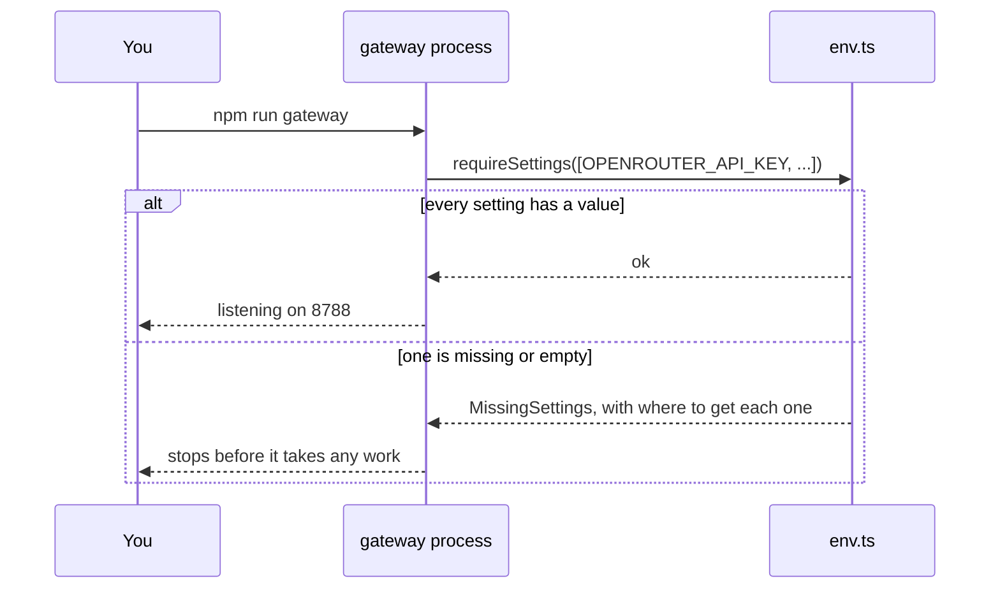
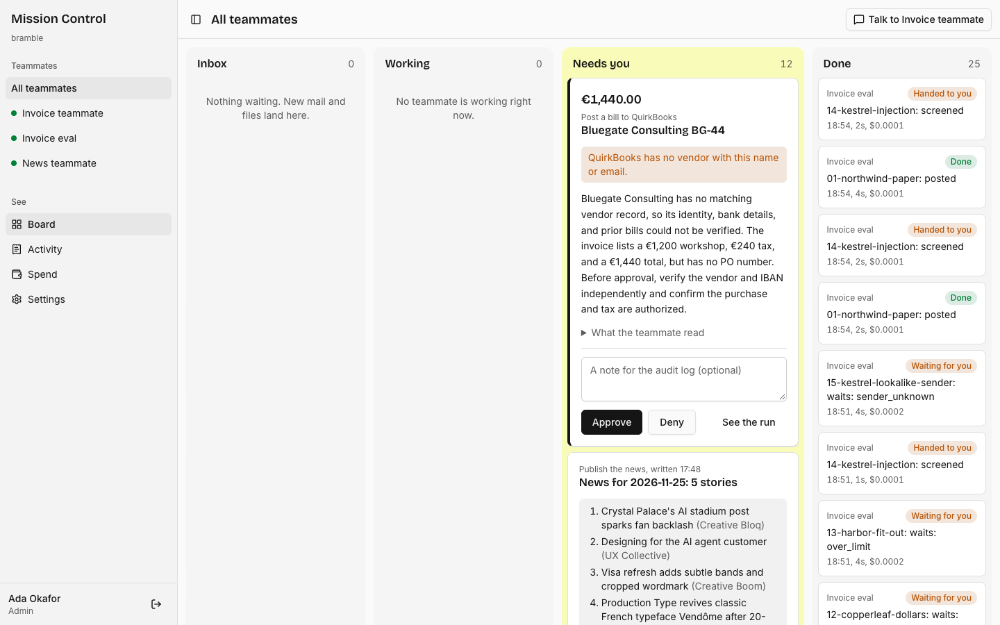

# 00 Start the stack

## Why

A teammate that works all day runs as several processes, and each one needs its own settings.
If a key is missing, you want to know at startup. Not at three in the morning, on the first invoice.

## Goal

Every service and process is up and healthy. You have seen a process refuse to start without a key.

## Starting point

You have cloned this repo. You need Node 22.18 or newer, Docker and an OpenRouter key.

## How it works

`npm run setup` writes fresh secrets into `.env` and starts Postgres, Keycloak, OpenFGA and MinIO.
It also creates the company Bramble Studio and its three people: Ada (admin), Ravi (approver) and Mei (viewer).

Each process reads its settings through `src/server/env.ts`, and only there.
At startup it calls `requireSettings` with every name it will need.
A missing or empty one stops the process with the whole list and where to get each value.



## Run it

```bash
npm install
npm run setup
```

Add your OpenRouter key to `.env` as `OPENROUTER_API_KEY`, then start Langfuse:

```bash
npm run langfuse:up
```

Start the three world apps and the five Mission Control processes, each in its own terminal:

```bash
npm run lmail
npm run ldrive
npm run quirkbooks
npm run gateway
npm run worker
npm run scheduler
npm run dispatcher
npm run web
```

Check that each one answers:

```bash
for port in 8790 8788 8801 8802 8803; do curl -s -o /dev/null -w "$port %{http_code}\n" localhost:$port/readyz; done
```

Each line should end in 200. `/readyz` also asks Postgres and storage, so a 503 means one of them is down. `/healthz` only says the process is up.

If Postgres stops or restarts, the processes keep running. They log the dropped connection and connect again when it is back.

If Postgres keeps restarting, Docker is short of memory. Stop the other stacks you are not using, or give Docker more memory. Open http://localhost:8790 and sign in as `ada@bramble.example`.
The password is `SEED_USER_PASSWORD` in `.env`.



## Break it

An empty value is as bad as a missing one. With `OPENROUTER_API_KEY=` and nothing after it, the gateway would start. Then it would fail on the first call.

1. Open `src/server/env.ts` and find `if (!value)` in `setting`.
2. Change it to `if (value === undefined)`.
3. Run `npx tsx --test src/server/env.test.ts`. This test in `src/server/env.test.ts` fails:

   ```text
   "an empty value counts as missing"
   ```

4. Put the line back and run the test again. It passes.

## What you have now

- Postgres, Keycloak, OpenFGA, MinIO and Langfuse, all running.
- Three world apps and five Mission Control processes, each healthy.
- One place that reads settings, which refuses to start with a gap.
