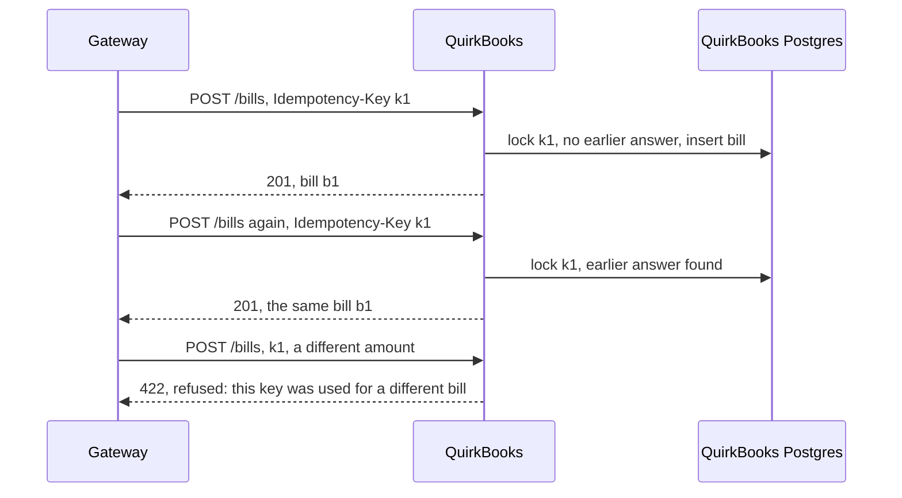
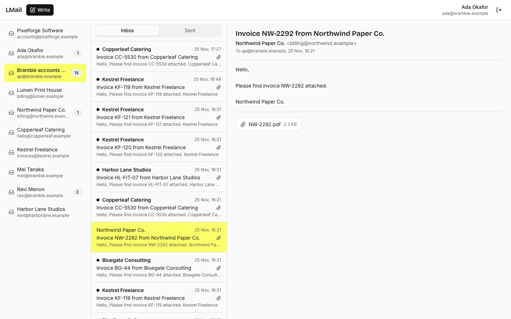
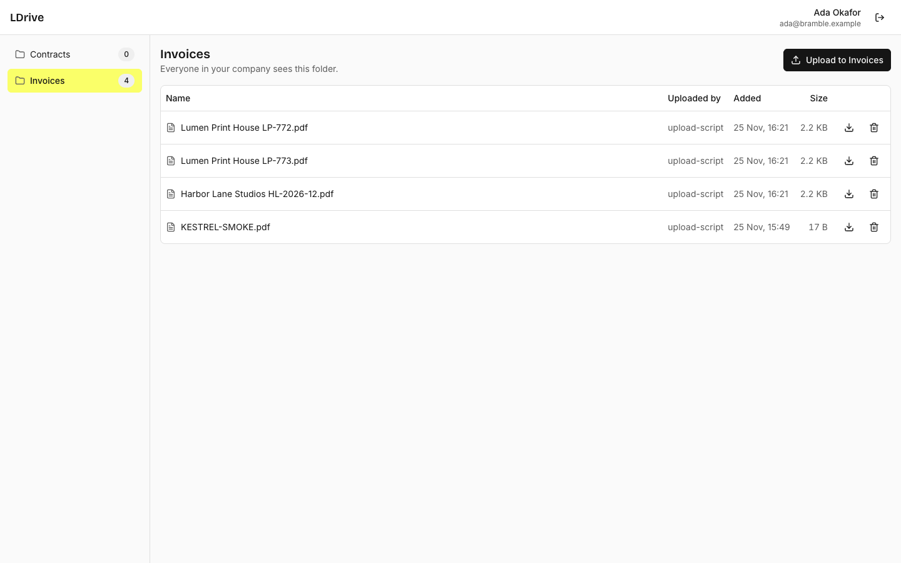
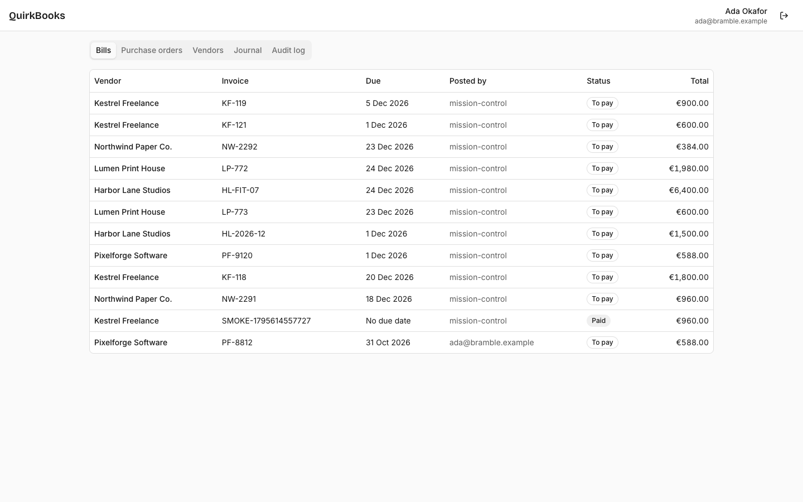

# 01 Meet the apps your teammates work in

## Why

A teammate is only as real as the tools it touches.
If it works against a pretend inbox, every lesson after this one proves nothing.
Here the mail, the files and the books are three real apps. Each has its own database, sign-in and API.

## Goal

You send a real invoice by mail and see it land in LMail. You also see QuirkBooks keep one bill when a request comes twice.

## Starting point

The stack from lesson 00 is running, and you are signed in as Ada.

## How it works

- **LMail** (port 8801) takes real mail by SMTP on port 2525. When mail arrives in a watched mailbox, it sends a signed notice to Mission Control. The notice is shaped like Gmail's: just the mailbox and a history number.
- **LDrive** (port 8802) keeps folders in MinIO. A new file in a watched folder sends a notice shaped like Google Drive's.
- **QuirkBooks** (port 8803) keeps vendors, purchase orders, bills and a double-entry journal. Every write lands in its audit log.

Mission Control reaches the three apps only through their APIs, with the keys `npm run setup` wrote.

A network can drop an answer after the work is done. So a careful client sends the request again.
QuirkBooks takes an `Idempotency-Key` on every bill.
It locks on that key, looks for an earlier answer, and returns it instead of posting twice.
The same key with a different bill is refused.



## Run it

Send one clean invoice by mail:

```bash
npm run invoices:send -- 01-northwind-paper
```

Open LMail at http://localhost:8801 and pick the Bramble accounts payable mailbox. The invoice is there with its PDF.



Open LDrive at http://localhost:8802. Its Invoices folder holds the cases sent as files.



Open QuirkBooks at http://localhost:8803. The Bills tab shows every bill and who posted it.



## Break it

Two workers can retry the same post at the same moment. Without the lock, both see no earlier answer and both insert.

1. Open `apps/quirkbooks/store.ts` and find `postBill`.
2. Delete the line with `pg_advisory_xact_lock`.
3. Run `npx tsx --test apps/quirkbooks/store.test.ts`. This test in `apps/quirkbooks/store.test.ts` fails:

   ```text
   "two posts with the same key at once still make one bill"
   ```

4. Put the line back. It passes again.

## What you have now

- Real mail in, real files in, real books, each behind its own API.
- A bill post that is safe to retry, even two at once.
