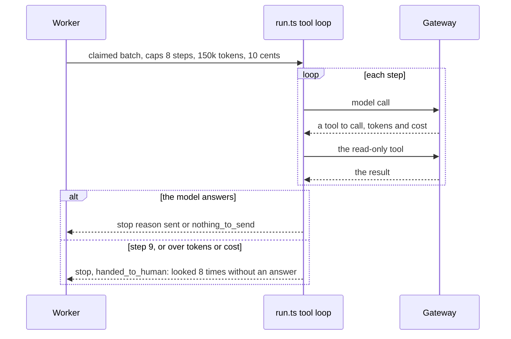

# Bound the agent loop

## Why

A model in a loop can keep asking for one more look. An agent loop is the cycle where a model asks for a tool, then reads the result.
Left alone, a confused run uses tokens all night and still ends with no answer. A token is a small piece of text. Models charge for each token they read and write.

A teammate that runs while nobody watches needs hard limits. When it hits one, it hands the work to a person.

For example, a run that keeps reading the same invoice stops after eight tool steps. Then a person takes over.

## Goal

You follow one run from start to finish: its steps, its cost and why it stopped. Then you see a looping run stop at the step limit.

## Starting point

The stack is running. At least one invoice has been through the board.

## How it works

The worker turns each claimed batch of inbox events into one run, in `src/server/run.ts`. Every run has the same shape:

1. It loads a stable system prompt and the list of tools. It also loads the teammate's instructions from memory, and the events. A system prompt is the standing instructions the model reads first. A tool is one action the model may ask for.
2. It works through the teammate's graph. A graph is a set of named steps, and the code runs them in order. Fixed steps are plain code. Open-ended steps are a tool loop that may only read.
3. Every model call and tool call goes through the gateway. The gateway is the one process that holds the keys and checks each call. It counts tokens and dollars.
4. It ends with one stop reason. The stop reason says how the run ended. The possible reasons are:

   - `sent`
   - `nothing_to_send`
   - `deferred`
   - `handed_to_human`
   - `failed`

The gateway is the article's credential proxy. A credential proxy holds the keys and makes the calls for others.

The worker holds no key to QuirkBooks or LMail. It holds no key to the model provider either. It holds one token, which lets it ask the gateway. The gateway holds the rest.

A run that is tricked into a bad call can only ask. The gateway can say no.

The limits sit in `RUN_CAPS`: 8 tool steps, 150,000 tokens and 10 US cents per run.
A cap is a hard limit. Breaking any of them ends the run as `handed_to_human`. It never retries on its own.

You can also ask a teammate a question from the run drawer. The drawer is the panel that opens when you click a card. It shows each step of the run.
That question uses the same tool loop, with the same limits.



## Run it

Send an invoice that fails a check, so the teammate has to look around:

```bash
npm run invoices:send -- 05-lumen-maths-error
```

Expect: the card reaches Needs approval on the board.

Open the card when it reaches Needs approval.
The drawer shows each step. It shows the tools the run read, and how the run ended.


At the bottom of the drawer, ask the teammate "Which purchase order does this invoice belong to?".
The answer comes from the same loop, with the same caps.

## Break it

The step cap stops a confused model from looping forever.

1. Open `src/server/run.ts` and find `steps > this.caps.maxLoopSteps`.
2. Change it to `steps > this.caps.maxLoopSteps * 1000`. The cap is now 8,000 steps, so it never stops the run.
3. Run `npx tsx --test src/server/run.test.ts`. This test in `src/server/run.test.ts` fails:

   ```text
   "a loop that never answers stops at the step limit and goes to a person"
   ```

4. Put it back. It passes.

## What you have now

- One run per batch, with the same shape for every teammate.
- Hard caps on steps, tokens and dollars.
- A stop reason on every run, and a person at the end of every failure.
