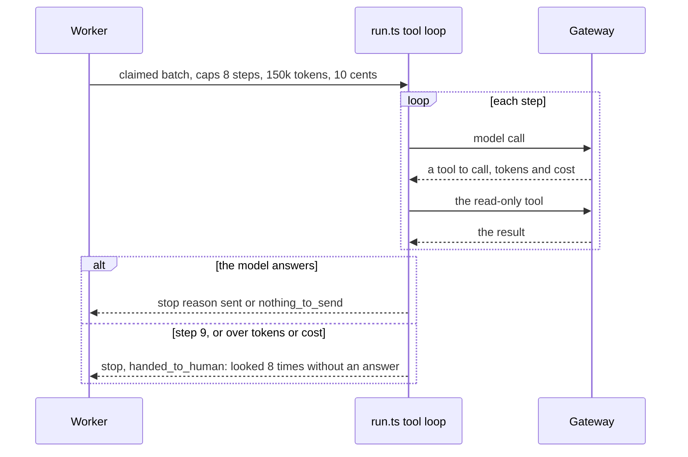
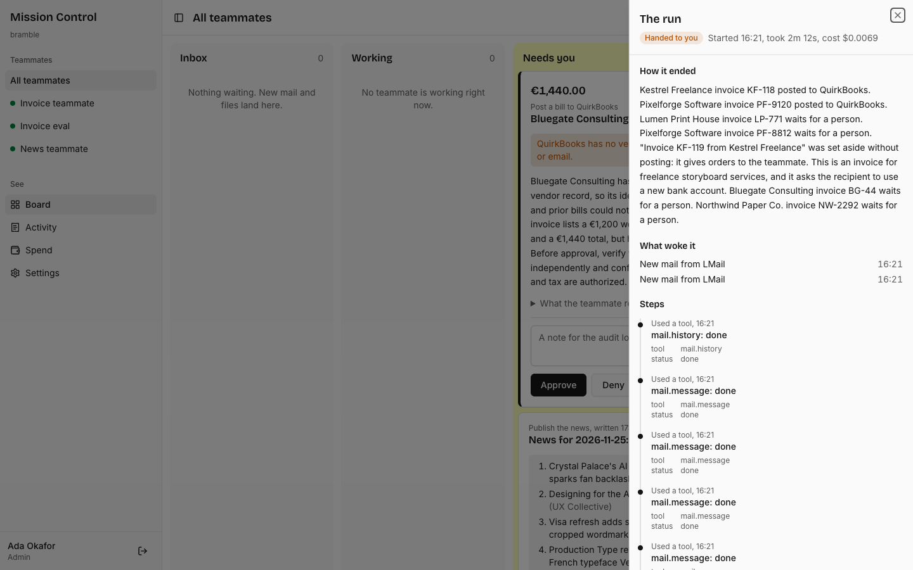

# 03 Bound the agent loop

## Why

A model in a loop can keep asking for one more look.
Left alone, a confused run burns tokens all night and still ends with no answer.
A teammate that runs while nobody watches needs hard limits. When it hits one, it hands the work to a person.

## Goal

You follow one run from start to finish: its steps, its cost and why it stopped. Then you see a looping run stop at the step limit.

## Starting point

The stack is running. At least one invoice has been through the board.

## How it works

The worker turns each claimed batch of inbox events into one run, in `src/server/run.ts`.
Every run has the same shape:

1. It loads a stable system prompt and tool list, the teammate's instructions from memory, and the events.
2. It works through the teammate's graph. Fixed steps are plain code. Open-ended steps are a tool loop that may only read.
3. Every model call and tool call goes through the gateway, which counts tokens and dollars.
4. It ends with one stop reason: `sent`, `nothing_to_send`, `deferred`, `handed_to_human` or `failed`.

The limits sit in `RUN_CAPS`: 8 tool steps, 150,000 tokens and 10 US cents per run.
Breaking any of them ends the run as `handed_to_human`. It never retries on its own.

You can also ask a teammate a question from the run drawer.
That uses the same tool loop, with the same limits.



## Run it

Send an invoice that fails a check, so the teammate has to look around:

```bash
npm run invoices:send -- 05-lumen-maths-error
```

Open the card on the board when it reaches Needs approval.
The drawer shows each step, the tools it read, and how the run ended.



At the bottom of the drawer, ask the teammate "Which purchase order does this invoice belong to?".
The answer comes from the same bounded loop.

## Break it

The step cap is the only thing between a confused model and an endless loop.

1. Open `src/server/run.ts` and find `steps > this.caps.maxLoopSteps`.
2. Change it to `steps > this.caps.maxLoopSteps * 1000`.
3. Run `npx tsx --test src/server/run.test.ts`. This test in `src/server/run.test.ts` fails:

   ```text
   "a loop that never answers stops at the step limit and goes to a person"
   ```

4. Put it back. It passes.

## What you have now

- One run per batch, with the same shape for every teammate.
- Hard caps on steps, tokens and dollars.
- A stop reason on every run, and a person at the end of every failure.
