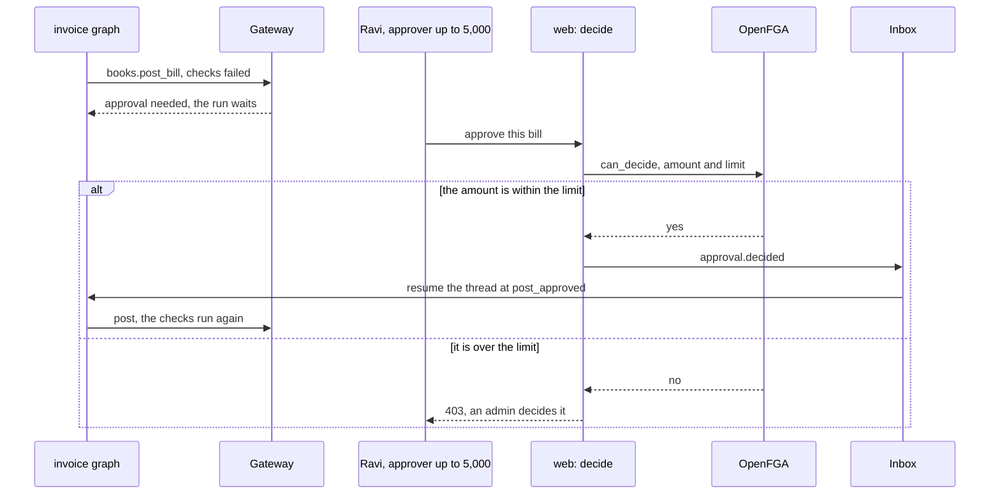
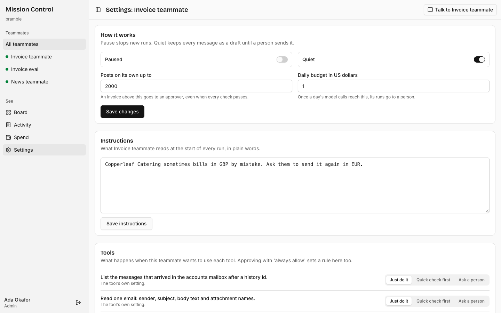

# 06 Ask a person before a risky action

## Why

A teammate that holds the keys to the books can be talked into anything a clever invoice asks.
So it never holds them.
The keys live in the gateway, and a policy decides every tool call. The risky ones wait for a person who may say yes.

## Goal

You approve one held invoice and deny another. You see who may decide what, and the one rule nobody can turn off.

## Starting point

The stack is running, and two invoices wait in Needs approval from lesson 05.

## How it works

Every tool call goes to the gateway. The gateway decides it in one of three ways:

- **allow**: run it now. Reading mail, reading the books and posting a bill whose checks passed are allowed.
- **classify**: a quick model call judges the risk. A reply to a vendor goes this way.
- **approve**: stop the run and ask a person.

A standing rule from an admin can change a tool's default.
Clicking "Allow always" on an approval writes such a rule, never a note in memory.

When the checks fail, `post` asks for an approval and the graph waits.
A person decides on the card. The decision goes into the teammate's inbox as an event. The worker then resumes the saved thread where it stopped.

Who may decide is checked in OpenFGA, from the person's Keycloak sign-in:
Ada is an admin and may decide any amount. Ravi may decide up to 5,000. Mei may only view.



## Run it

Open a held card, read the brief, and approve it. Open the other and deny it with a note.
Open Activity. Under the outbox, the audit log has both decisions with your name and your note.

Sign in as `mei@bramble.example` in a private window. Mei sees the same cards. In place of the buttons, each card says she can view approvals but not decide them.

Open Settings as Ada. Each tool shows its default, and you can set a standing rule for it.



## Break it

A standing rule must never let a bill skip its checks. Otherwise one click on Allow always turns them off for good.

1. Open `src/server/web-app.ts` and find `if (tool === "books.post_bill") throw new HttpError(422`.
2. Delete that line.
3. Run `npx tsx --test src/server/web-app.test.ts`. This test in `src/server/web-app.test.ts` fails:

   ```text
   "no standing rule can let a bill post without its checks"
   ```

4. Put it back. It passes.

## What you have now

- Keys in the gateway, never in the run.
- allow, classify and approve for every tool, with standing rules on top.
- Approvals by role and limit, checked in OpenFGA, and a run that resumes after the answer.
