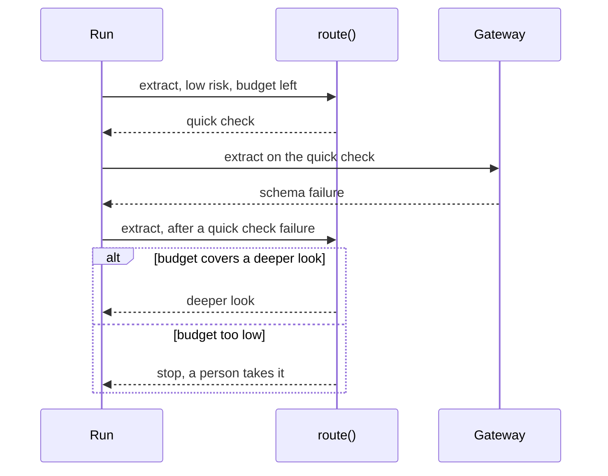
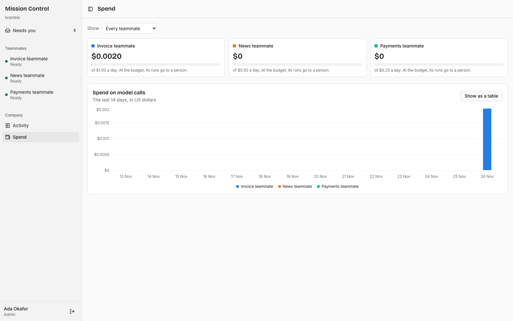

# 07 Route each call to the right model

## Why

A teammate that reads every invoice with the strongest model pays for it on every invoice.
One that uses only the cheapest model saves money and misses the invoice that matters.
Routing sends each call to the cheapest model that can do it. It steps up when that fails. It stops at a person when the budget is gone.

## Goal

You read the routing rules, see spend per teammate, and compare three routing setups on the same invoices.

## Starting point

The stack is running, and several invoices have been through the board.

## How it works

There are two tiers: a quick check and a deeper look. The UI never names the model, only the tier.

`route` in `src/server/router.ts` is a plain function. It takes the task, the risk, the dollars left today and how earlier tries went:

- `classify`, `extract`, `summarize` and `answer` start on the quick check.
- `screen`, `investigate`, `brief`, `select`, `tidy` and `act` go to the deeper look. Screening moved there after the quick check missed the injection invoice 4 times in 10.
- `act` is a chat that may set a follow-up or take on a bill in a person's name. On the quick check it once set a follow-up for the wrong day. The next time, it set none.
- A schema failure or an error on the quick check steps up to the deeper look. Low confidence steps up only when the risk is high.
- A failure on the deeper look goes to a person.
- When the day's budget cannot cover one deeper look, the call goes to a person.

Every reason is a line in the run drawer and a span attribute in Langfuse.
The gateway records the cost of every call. The spend page and the budget read the same rows.



## Run it

Open Spend in Mission Control. It shows each teammate's cost per day against its budget.



Score the three setups on all fifteen invoice cases, with real model calls:

```bash
npm run invoices:run -- --routing all
```

On our run, the scoreboard read:

| Routing | Right | Wrong postings | Cost per 100 invoices |
| --- | --- | --- | --- |
| routed | 15 of 15 | 0 | 1.1 US cents |
| fast-only | 14 of 15 | 0 | 0.8 US cents |
| strong-only | 15 of 15 | 0 | 1.7 US cents |

The quick check alone missed the injection invoice. The bank check still held that invoice, so nothing wrong posted. But the scoreboard counts the missed screen as wrong.
Routing matches the deeper look on every case at about two thirds of its cost.
Your numbers will differ a little from run to run.

## Break it

The step-up after a schema failure is what keeps a garbled answer from reaching the checks.

1. Open `src/server/router.ts` and find `failedHard`.
2. Change its last line from `return true;` to `return outcome.result !== "schema_failure";`.
3. Run `npx tsx --test src/server/router.test.ts`. This test in `src/server/router.test.ts` fails:

   ```text
   "a schema failure or an error on fast goes to strong"
   ```

4. Put it back. It passes.

## What you have now

- One plain function that picks the tier, with a reason for every choice.
- Cost recorded per call, a daily budget per teammate, and a person when it runs out.
- A scoreboard that shows what routing buys you.
