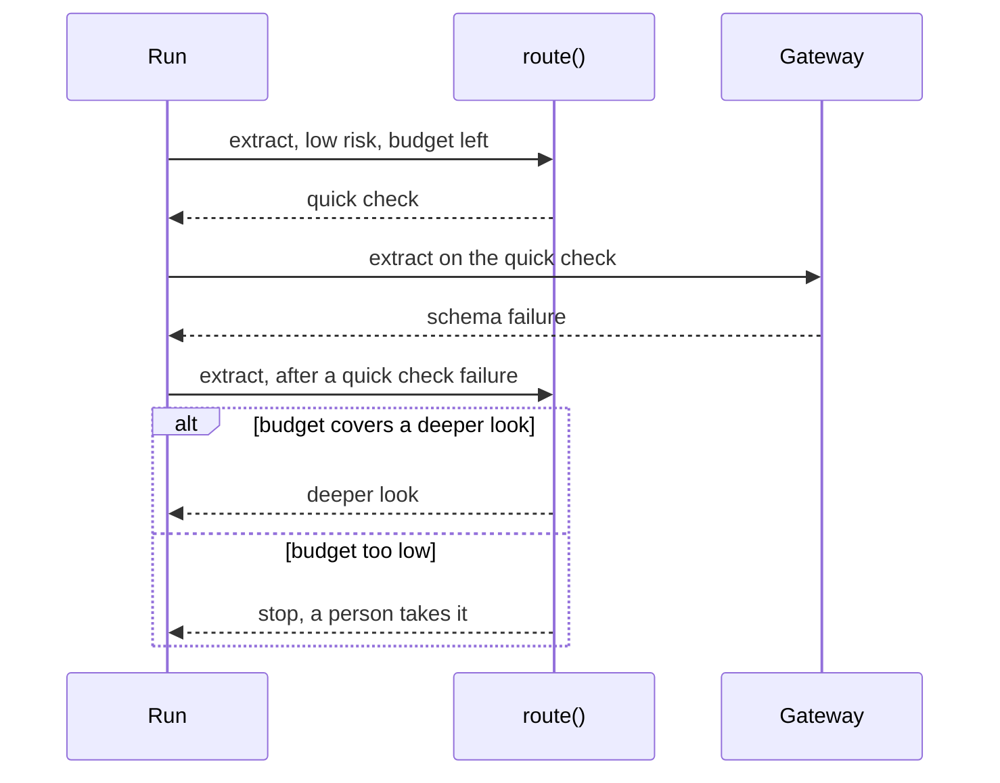

# Route each call to the right model

## Why

A teammate that reads every invoice with the strongest model pays for it on every invoice. The strongest model costs the most per call.

A teammate that uses only the cheapest model saves money, but it misses the invoice that matters.
Routing sends each call to the cheapest model that can do the job. It steps up to a stronger model when that fails. It stops and asks a person when the budget is gone.

For example, an extract call that returns broken output goes to the stronger model and tries again.

## Goal

You read the routing rules and see spend per teammate. You also compare three routing setups on the same invoices.

## Starting point

The stack is running, and several invoices have been through the board.

## How it works

There are two tiers, a quick check and a deeper look. The quick check is cheaper. The deeper look is stronger and costs more.
The UI never names the model, only the tier.

`route` in `src/server/router.ts` is a plain function. It takes the task and the risk. It also takes the dollars left today and how earlier tries went:

- Start on the quick check: `classify` and `extract`.
- Start on the quick check too: `summarize` and `answer`.
- Go to the deeper look: `screen` and `investigate`.
- Also the deeper look: `brief` and `select`.
- Also the deeper look: `tidy` and `act`. Screening moved there after the quick check missed the injection invoice 4 times in 10. An injection invoice is one that tries to give the model new orders.
- `act` is a chat that may set a follow-up or take on a bill in a person's name. On the quick check it once set a follow-up for the wrong day. The next time, it set none.
- A schema failure steps up to the deeper look. So does an error on the quick check. A schema failure means the answer does not match the shape the code expects. Low confidence steps up only when the risk is high.
- A failure on the deeper look goes to a person.
- When the day's budget cannot cover one deeper look, the call goes to a person.

Every reason shows as a line in the run drawer and as a label on the Langfuse trace.
The gateway records the cost of every call. The spend page and the budget read the same records.



## Run it

Open Spend in Mission Control. It shows each teammate's cost per day against its budget.


Score the three setups on all fifteen invoice cases, with real model calls:

```bash
npm run invoices:run -- --routing all
```

Expect: a scoreboard with one row for each setup.

On our run, the scoreboard read:

| Routing | Right | Wrong postings | Cost per 100 invoices |
| --- | --- | --- | --- |
| routed | 15 of 15 | 0 | 1.1 US cents |
| fast-only | 14 of 15 | 0 | 0.8 US cents |
| strong-only | 15 of 15 | 0 | 1.7 US cents |

Here, `routed` is the routing in this lesson. `fast-only` uses the quick check alone. `strong-only` uses the deeper look alone.

The quick check alone missed the injection invoice. The bank check still held that invoice, so nothing wrong was posted.
But the scoreboard counts the missed screen as wrong.
Routing gets the same score as the deeper look alone, for about two thirds of the cost.
Your numbers will differ a little from run to run.

## Break it

The step-up after a schema failure keeps a garbled answer from reaching the checks. A garbled answer is one the code cannot read.

1. Open `src/server/router.ts` and find `failedHard`.
2. Change its last line from `return true;` to `return outcome.result !== "schema_failure";`.
3. Run `npx tsx --test src/server/router.test.ts`. This test in `src/server/router.test.ts` fails:

   ```text
   "a schema failure or an error on fast goes to strong"
   ```

4. Put it back. It passes.

## What you have now

- One plain function that picks the tier, with a reason for every choice.
- Cost is recorded per call. Each teammate has a daily budget. A person takes over when the budget runs out.
- A scoreboard that shows what routing buys you.
