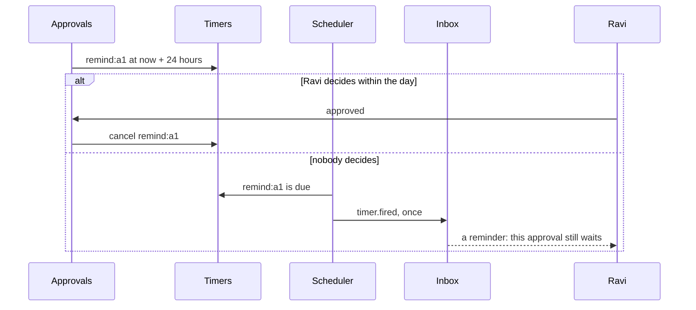
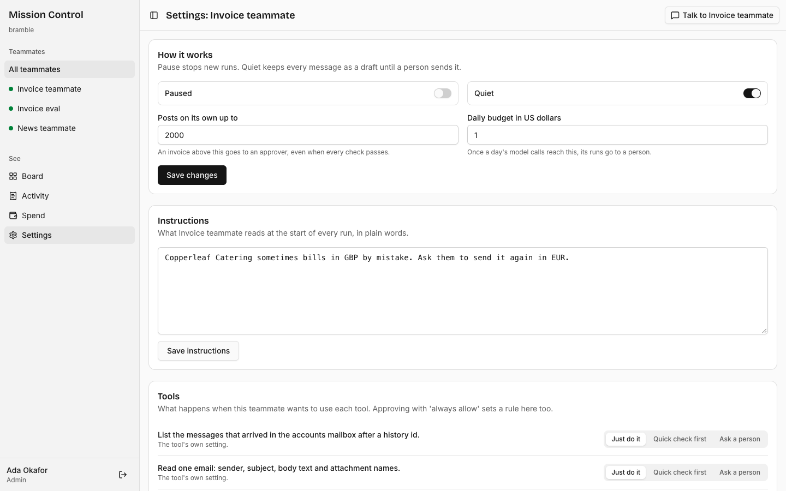

# 08 Follow up on time and remember what people decided

## Why

An approval that nobody answers sits there for a week, and the vendor waits for its money.
Ravi approved a vendor's new bank account last month. A teammate that forgets this asks him again.
An always-on teammate needs a clock it can trust and a memory that outlives every run.

## Goal

You see the reminder an approval sets and the daily schedules. You also see a vendor note written from a decision.

## Starting point

The stack is running. At least one approval was decided in lesson 06.

## How it works

**Timers** live in their own table, in `src/server/timers.ts`. A timer is either a schedule (a cron line in the company's time zone) or a single time.

- The invoice teammate sends a digest at six on working evenings. The news teammate starts its edition at seven on working mornings.
- Every new approval sets a reminder for 24 hours later. A decision cancels it.

The scheduler never starts a run. It writes each due timer into the teammate's inbox, once. The worker takes it like any other event.
A scheduler that was down for days fires a schedule once, not once per missed time.

**Memory** is a folder of plain text files per teammate on S3, in `src/server/memory.ts`.
It holds only what cannot be looked up again:

- `instructions.md`: what a person wants the teammate to know. An admin edits it in Settings, and every run reads it.
- `notes/vendor-<id>.md`: one note per vendor, written from each decision a person made. A note keeps its newest 30 lines.

Facts that live in QuirkBooks or LMail stay there. Memory never copies them.



## Run it

Send an invoice that will wait, and look at its reminder:

```bash
npm run invoices:send -- 06-pixelforge-duplicate
docker exec teammates-platform-postgres-1 \
  psql -U teammates -d teammates -c "SELECT name, cron, fire_at, status FROM timers ORDER BY fire_at"
```

You see the standing schedules and one `remind:` timer a day ahead.
Approve the invoice and run the query again. The reminder's status is now `cancelled`.

Open Settings as Ada. Add a line to the invoice teammate's instructions. For example: Copperleaf bills in US dollars. The next run reads it.



## Break it

A reminder that outlives its approval nags people about something already done.

1. Open `src/server/approvals.ts` and find `cancelTimer` in `decide`.
2. Delete that line.
3. Run `npx tsx --test src/server/timers.test.ts`. This test in `src/server/timers.test.ts` fails:

   ```text
   "an approval sets a reminder for a day later, and a decision cancels it"
   ```

4. Put it back. It passes.

## What you have now

- Schedules and follow-ups in their own table, fired once into the inbox.
- A reminder on every approval, cancelled by the decision.
- Instructions and vendor notes that outlive every run, and nothing copied from the books.
