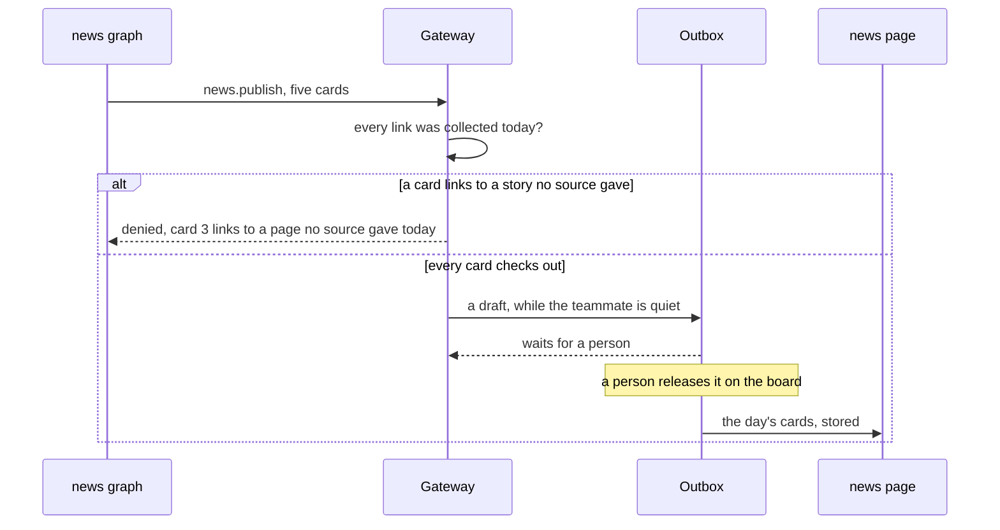
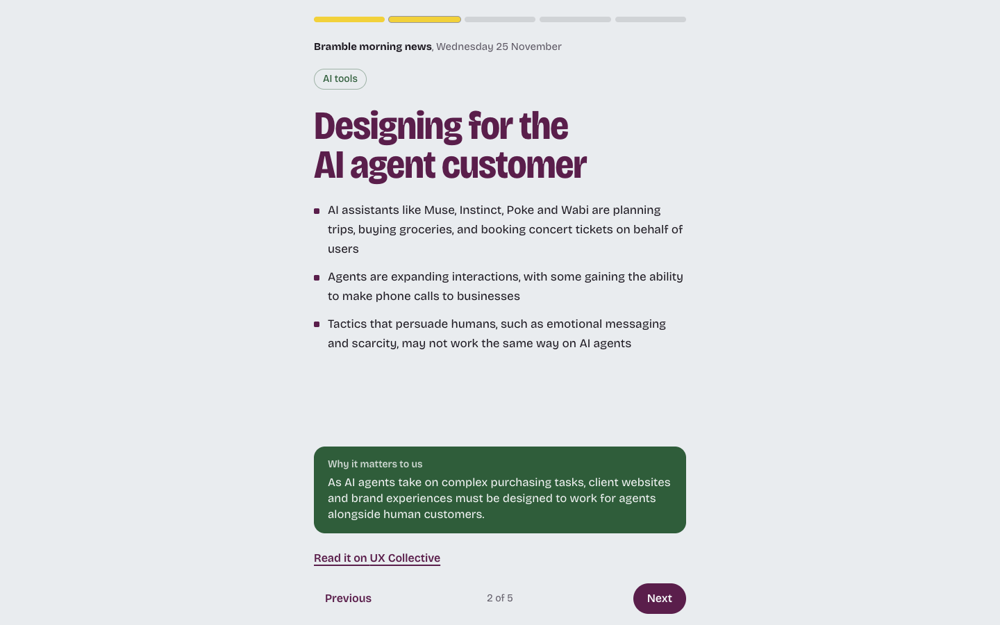

# 09 Publish the morning news

## Why

A news teammate that writes its own summaries can invent a story. Or it can link to a page no source gave.
Once that is published, people share it.
So the model picks and writes, but plain code decides whether a card may go out.

## Goal

You start an edition by hand and release it from the board. Then you read the cards on Mission Control's news page.

## Starting point

The stack is running and you can sign in to Mission Control. The news sources are public, so there is no key to set. An `EXA_API_KEY` in `.env` adds Exa as a source.

## How it works

The news teammate is a graph in `src/server/teammates/news/graph.ts`:

| Node | What it does |
| --- | --- |
| `collect` | Reads RSS feeds, Hacker News and GDELT, plus Exa when it has a key. Drops stories published before. |
| `dedupe` | Keeps the first of each story: the same link, or the same headline from two sources. Plain code. |
| `select` | A deeper-look model call picks up to five stories. |
| `write` | Reads each article and writes one card: a headline, three points and why it matters. |
| `check` | Plain checks on every card. |
| `publish` | Hands the edition to the outbox through the gateway. |

The gateway checks the edition again before it takes it, in `editionProblems`.
Every card must link to a story a source gave that day. No card may repeat an earlier edition or this one.

The teammate starts quiet. So its edition waits as a draft on the board until a person releases it.
The dispatcher then writes the day's cards to the stack's storage, in `src/server/news-shelf.ts`. Mission Control serves them at `/news/`, to people of that company who may see the news teammate.

With `NEWS_TARGET=github` the dispatcher commits them to your fork of this repo instead. Its Pages workflow puts them live. The README says how to set that up.



## Run it

The edition runs at seven on working mornings. To start it now, move its timer:

```bash
docker exec teammates-platform-postgres-1 \
  psql -U teammates -d teammates -c "UPDATE timers SET fire_at = now() WHERE teammate = 'news' AND name = 'edition'"
```

The scheduler fires it within a few seconds. Watch the news card move through Working to the outbox as a draft.
Open it, read the cards, and send it.

Open http://localhost:8790/news/ and the cards are there.
Swipe or use the arrow keys to move through the day.



## Break it

The gateway's check is the last line between an invented link and the public page.

1. Open `src/server/tools/news.ts` and find `if (problems.length) return { deny` in the guard of `news.publish`.
2. Delete that line.
3. Run `npx tsx --test src/server/gateway-app.test.ts`. This test in `src/server/gateway-app.test.ts` fails:

   ```text
   "the news is refused when a card links to a story no source gave that day"
   ```

4. Put it back. It passes.

## What you have now

- A daily news graph with two model calls and plain code around them.
- A check that refuses any card the sources did not give.
- An edition that waits for a person, then goes live on Mission Control's news page.
