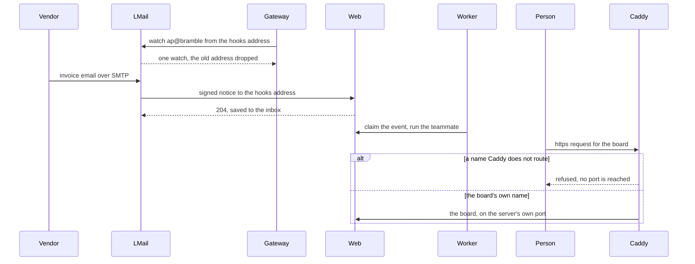

# Deploy the teammates to a server

## Why

On a laptop, the teammates sleep when the lid closes. An always-on teammate needs a machine that stays on.

A real company's invoices also arrive in a real inbox, not the workshop's own.

Moving to a server changes the addresses people open. Sign-in, the apps' notices and the board must all move to the new addresses.
If one address stays behind, notices go to a port that nobody listens on. The work is then lost, and nothing reports it.

For example, the apps still send notices to your laptop. The server never hears about an invoice.

## Goal

You run every process from one image, as on a server. Then you put a real domain with TLS in front of it.
Last, you can point the invoice teammate at a real Gmail inbox and Google Drive.

## Starting point

The stack from [Start the stack](00-start-the-stack.md) is running. You have a server with Docker.

You also have a domain, such as `example.com`. DNS records point its names at the server. DNS is the service that maps a name to a server address.
The names are the domain itself, plus four more:

- `auth.` for sign-in
- `mail.` for LMail
- `drive.` for LDrive
- `books.` for QuirkBooks

## How it works

The `Dockerfile` builds one image. An image is a packed copy of the app that Docker can start.
It holds the three apps and Mission Control's five processes.
`deploy/docker-compose.yml` starts eight containers from that image, one per process. A container is one running copy of the image.

Each container uses the host's network. The host is the server.
So each container reaches Postgres and Keycloak on the same ports as on your laptop. It reaches OpenFGA and MinIO the same way.

Every port listens on the server only. Caddy is the one door in. It is a web server.

Caddy holds the TLS certificates. TLS is the encryption behind https.
Caddy sends each name to its port, as `deploy/Caddyfile` says.

`scripts/addresses.ts` decides the addresses a browser opens. With no `PUBLIC_DOMAIN`, each one is a localhost port.
With `PUBLIC_DOMAIN` set, each one is an https name. Setup writes them, and Keycloak signs people in on the new name.

The apps' notices never leave the server. They go to Mission Control's local port, named by `HOOKS_URL`.

The hooks address is where the apps send their notices.
When that address changes, the gateway moves every watch the next time it starts. A watch is a request that asks an app to send its notices to an address.
The old address gets no more notices.



## Run it

First, run every process from the image on your laptop. Stop the ones you started by hand, then:

```bash
docker compose -f deploy/docker-compose.yml up -d --build --wait
docker compose -f deploy/docker-compose.yml ps
```

Expect: `ps` lists every process as Up. The five with a web port show healthy.

Send an invoice as in [Meet the apps your teammates work in](01-meet-the-world.md), and the worker takes it.

On the server, clone the repo. Add your OpenRouter key, then run `npm run setup`.

Then add `PUBLIC_DOMAIN=teammates.example.com` to `.env`, using your own domain. Run setup again.
It writes the https addresses and moves each sign-in to them. Start the processes and the proxy:

```bash
npm run setup
docker compose -f deploy/docker-compose.yml --profile public up -d --build --wait
```

Expect: the command returns once every container is healthy.

Open your domain and sign in. Keycloak is now at `auth.` in front of your domain.
Only its sign-in pages are public. 

For the admin console, open a tunnel from your laptop. Then visit port 8190 on localhost.
A tunnel is a secure path from your laptop to the server:

```bash
ssh -L 8190:localhost:8190 you@your-server
```

Expect: the terminal stays open. Keep it open while you use the console.

### Read a real Google account

The invoice teammate can read Gmail and Google Drive instead of LMail and LDrive. It asks them the same questions, so the teammate does not change.
QuirkBooks stays the books. One Google account serves one company.

1. In the Google Cloud console, turn on three APIs: Gmail, Drive and Pub/Sub. Pub/Sub is Google's message service.
2. Make an OAuth client of the Desktop app kind. OAuth is the way an app gets permission from a Google account. Put its id and secret in `.env` as `GOOGLE_CLIENT_ID` and `GOOGLE_CLIENT_SECRET`.
3. Run the consent script below and allow access. It writes `GOOGLE_REFRESH_TOKEN` into `.env` and never prints it. That token lets the app ask Google for access later.
4. Make a Pub/Sub topic, and let `gmail-api-push@system.gserviceaccount.com` publish to it.
5. Make a push subscription on that topic. It sends each message to your domain plus `/hooks/gmail/bramble`. Turn on authentication with a service account. A service account is a robot account that a program signs in with.
6. Set `MAIL_SERVICE=gmail` and `FILE_SERVICE=gdrive`. Set `GMAIL_ADDRESS`, `GMAIL_PUBSUB_TOPIC` and `GMAIL_PUSH_SERVICE_ACCOUNT`.
7. Set `HOOKS_URL` to your https domain, since Google must reach the hooks. Restart the processes.

```bash
npm run google:consent
```

Expect: the script asks you to allow access, then ends. `.env` now has `GOOGLE_REFRESH_TOKEN`.

Gmail's notice carries a token that Google signs. The web process checks three things:

- The token must be Google's.
- It must be made for this hook's address.
- It must come from the service account you named.

Drive's notice carries the secret token of its channel. A channel is a watch on Drive. LDrive's does the same.

Gmail takes no idempotency key, so the gateway keeps its own record of each send.
A reply whose answer never came may have gone out. The gateway refuses to send it again, and the outbox shows why.
Look in Sent before you send it again by hand.

Keep two things safe. The `.env` file holds every secret.
The Postgres and MinIO volumes hold every invoice, run and memory note. A volume is the saved data that Docker keeps for a container.

## Break it

The gateway must move a watch when the hooks address changes. Otherwise an invoice can vanish after a move.

1. Open `src/server/subscriptions.ts` and find `held.address !== address` in `due`.
2. Delete that check, with the `||` after it.
3. Run `npx tsx --test src/server/subscriptions.test.ts`. This test in `src/server/subscriptions.test.ts` fails:

   ```text
   "a new hooks address moves every subscription and stops the old drive channel"
   ```

4. Put it back. It passes.

## What you have now

- Every process from one image, restarted by Docker when it stops.
- There is one door in, with TLS. Every other port is closed to the internet.
- Addresses that follow your domain, and watches that follow the hooks address.
- The same teammate reading a real Gmail inbox and Drive, if you choose.
