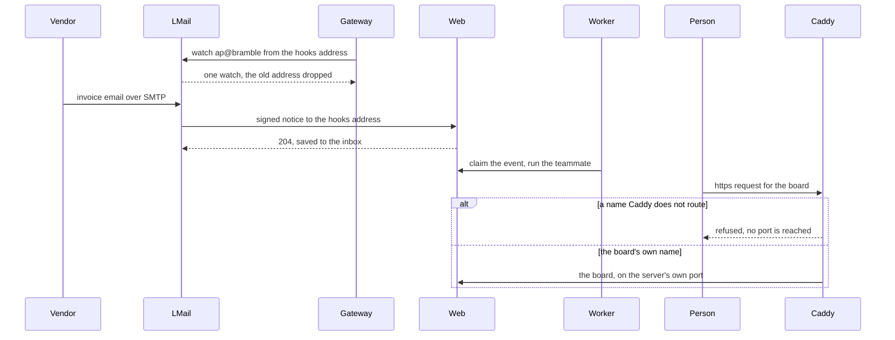

# 11 Deploy the teammates to a server

## Why

On a laptop, the teammates sleep when the lid closes. An always-on teammate needs a machine that stays on.

Moving to a server changes the addresses people open. Sign-in, the apps' notices and the board must all follow.
If one address stays behind, notices go to a port nobody listens on. The work is then lost without a sound.

## Goal

You run every process from one image, as on a server. Then you put a real domain with TLS in front of it.

## Starting point

The stack from lesson 00 is running. You have a server with Docker, and a domain whose names point at it.
The names are the domain itself, plus `auth.`, `mail.`, `drive.` and `books.` in front of it.

## How it works

The `Dockerfile` builds one image. It holds the three apps and Mission Control's five processes.
`deploy/docker-compose.yml` starts eight containers from that image, one per process.

Each container uses the host's network. So it reaches Postgres, Keycloak, OpenFGA and MinIO on the same ports as on your laptop.
Every port listens on the server only. Caddy is the one door in.
It holds the TLS certificates and sends each name to its port, as `deploy/Caddyfile` says.

`scripts/addresses.ts` decides the addresses a browser opens. With no `PUBLIC_DOMAIN`, each one is a localhost port.
With `PUBLIC_DOMAIN` set, each one is an https name. Setup writes them, and Keycloak signs people in on the new name.

The apps' notices never leave the server. They go to Mission Control's local port, named by `HOOKS_URL`.
When that address changes, the gateway moves every watch the next time it starts. The old address gets no more notices.



## Run it

First, run every process from the image on your laptop. Stop the ones you started by hand, then:

```bash
docker compose -f deploy/docker-compose.yml up -d --build --wait
docker compose -f deploy/docker-compose.yml ps
```

Every process shows Up. The five with a web port show healthy. Send an invoice as in lesson 01, and the worker takes it.

On the server, clone the repo, add your OpenRouter key and run `npm run setup`.
Then add `PUBLIC_DOMAIN=teammates.example.com` to `.env`, with your own domain. Run setup again.
It writes the https addresses and moves each sign-in to them. Start the processes and the proxy:

```bash
npm run setup
docker compose -f deploy/docker-compose.yml --profile public up -d --build --wait
```

Open your domain and sign in. Keycloak is now at `auth.` in front of your domain.

Keep two things safe. The `.env` file holds every secret. The Postgres and MinIO volumes hold every invoice, run and memory note.

## Break it

The gateway must move a watch when the hooks address changes. Otherwise an invoice can vanish after a move.

1. Open `src/server/subscriptions.ts` and find `held.address !== address` in `due`.
2. Delete that check, with the `||` after it.
3. Run `npx tsx --test src/server/subscriptions.test.ts`. This test in `src/server/subscriptions.test.ts` fails:

   ```text
   "a new hooks address moves every subscription and stops the old drive channel"
   ```

4. Put it back. It passes.

## What you have now

- Every process from one image, restarted by Docker when it stops.
- One door in, with TLS, and every other port closed to the internet.
- Addresses that follow your domain, and watches that follow the hooks address.
