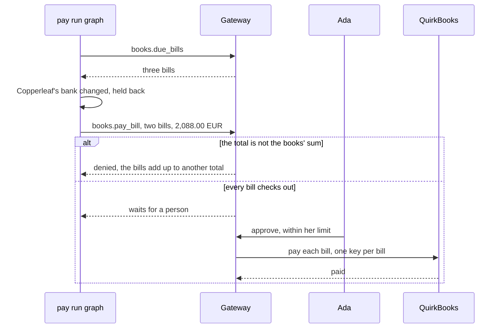
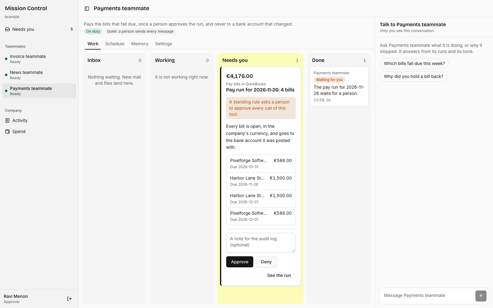

# Build a payments teammate from one definition

## Why

The teammates share one core. It has the five parts from the article, which is Building always-on agents.
A new teammate should reuse all five and add only its own job. If each new job means changes across the core, every teammate can break the others.

Paying bills is the riskiest job yet. Money leaves the company.
For example, a fraudster changes a vendor's bank details. Then the next pay run sends the money to the new account.

## Goal

You read how the payments teammate is defined in one folder. You run a pay run and approve it. Then you see two bills paid in QuirkBooks. The bill whose bank changed is held back.

## Starting point

The stack is running and you can sign in to Mission Control as Ada. QuirkBooks has three open bills to pay.
Harbor Lane's rent and Copperleaf's catering fall due this week, and Pixelforge's licence is overdue.
Copperleaf's bank details changed after its bill posted.

## How it works

A teammate is one folder under `src/server/teammates/` and one name in `registry.ts`. The registry is the list of teammates.
The definition in `payments/teammate.ts` says everything the core needs:

| Field | For payments |
| --- | --- |
| `tools` | `books.due_bills`, `books.pay_bill`, and the memory and team tools every teammate lists. |
| `schedules` | The pay run at nine on working mornings, and the evening digest. |
| `capabilities` | Chat that reads the due bills. No follow-ups. A digest. |
| `evaluate` | `data/payments/eval.ts`, which scores the checks against the live books. |
| `attacks` | A run with a changed bank, and a run whose total is lower than its bills. |

The gateway lets the teammate call only those tools. The scheduler gives it only those timers. `docs/teammates.md` lists every field.

The pay run is a graph in `payments/graph.ts`. It calls no model.
The books know which bills are due and which bank each was posted with. They also know the total. So plain code decides.

There are three walls. Each one checks facts that the model never supplies:

1. The graph checks each bill with `payProblems` and holds back the ones that fail.
2. The gateway's guard on `books.pay_bill` reads every bill again. It refuses a run whose total is not the books' own sum. That total is the amount on the approval card. So a person's approval limit is checked against the true sum.
3. QuirkBooks itself refuses to pay a bill whose vendor's bank changed after it posted.



### Two teammates working together

A bill can fall due before the next pay run. So the invoice teammate checks each bill it posts.
If a bill falls due within five days, it asks the payments teammate to run today.
It calls `team.ask_teammate`. The ask lands in Payments' inbox as a `teammate.request` event.

Two lists must match before an ask goes through.
The invoice teammate must list `team.ask_teammate` in its tools. The payments teammate must name `invoice` in `takesAsksFrom`.
If either list is missing, the gateway refuses the ask.

The ask moves no money. Payments starts the day's pay run and checks every bill again. A person still approves the card.
Paying records the payment in QuirkBooks. No bank money moves in this workshop.



## Run it

The pay run fires at nine on working mornings. To start it now, move its timer:

```bash
docker exec teammates-platform-postgres-1 \
  psql -U teammates -d teammates -c "UPDATE timers SET fire_at = now() WHERE teammate = 'payments' AND name = 'pay-run'"
```

Expect: the payments card on the board moves to Waiting.

Open the approval. It lists every open bill due within five days.

On a fresh stack, the run has two bills. They total 2,088.00 EUR. Bills you posted in earlier lessons join the run if they fall due in that window. Approve it as Ada.

Open QuirkBooks at http://localhost:8803 and look at the bills. Harbor Lane's rent and the Pixelforge licence are paid. Copperleaf is still open.
The audit log has one `bill.paid` line per bill, with the reason Ada approved.

Now attack it:

```bash
npm run teammate:attack -- payments
npm run teammate:eval -- payments
```

Expect: both commands pass. The eval never pays. Every run it sends is one the gateway must refuse.

To start a teammate of your own, write it from the template:

```bash
npm run teammate:new -- late-fees
npm run check
```

Expect: the check passes before you change anything.

The skill in `.claude/skills/new-teammate` walks Claude Code through the rest. Claude Code is an AI coding assistant that runs in your terminal.

## Break it

The guard's sum check keeps the card honest. Without it, a small number on the card could let a large run slip past a person's limit.

1. Open `src/server/tools/books.ts` and find `if (sum !== args.total) return { deny` in the guard of `books.pay_bill`.
2. Delete that line.
3. Run `npx tsx --test src/server/gateway-app.test.ts`. This test in `src/server/gateway-app.test.ts` fails:

   ```text
   "a pay run is refused unless every bill may be paid and the total is the books' own sum"
   ```

4. Put it back. It passes.

The hand-off has its own guard: the two lists must match.

1. Open `src/server/teammates/invoice/teammate.ts` and find `"team.ask_teammate",` in its tools.
2. Delete that line.
3. Run `npx tsx --test src/server/teammates/registry.test.ts`. This test in `src/server/teammates/registry.test.ts` fails:

   ```text
   "every kind a teammate takes asks from exists and may ask, and every teammate that asks has someone to ask"
   ```

4. Put it back. It passes.

## What you have now

- A third teammate that touches no core file: one folder and one line in the registry.
- A pay run checked three times from the books' own facts, and approved by a person every time.
- A template and a skill that start the next teammate with a passing check.
