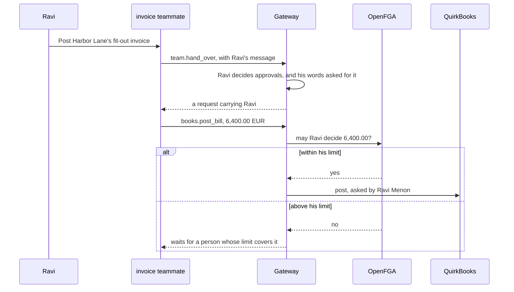

# 13 Talk to a teammate and hand it work

## Why

A teammate you can only watch is a dashboard. People want to write "post Lumen's invoice" or "check their reply on Friday" and have it done.

That is where a chat goes wrong. A mail can hold words that look like a person asking. And a teammate that acts for whoever writes to it holds more power than any one of them.

So the article's permissions primitive applies to chat too. The work runs with the access of the person who asked, never more.

## Goal

You hand the invoice teammate a bill as Ravi. It posts under Ravi's own approval limit, and waits for Ada when the bill is above it. You ask it to follow up on Friday, and a timer appears.

## Starting point

Lessons 00 to 08 are done and the stack is running. You can sign in as Ravi, an approver whose limit is 5,000 EUR, and as Ada.

## How it works

The chat panel is "Talk to Invoice teammate" on the right of Mission Control. A message is an inbox event like a mail. A run answers it with the teammate's own tools and rules.

`capabilities.chat` in the teammate's definition says how far chat may go:

- `read`: the teammate answers from the tools in `reads`, and writes nothing.
- `act`: it may also make small writes that stay inside the company. It can set a follow-up, keep a note, or take a bill handed over with `team.hand_over`.

An `act` chat finds a bill with `mail.search`, by its number or sender. It gets the next seven days by name, so "on Friday" is a lookup, not a sum. It runs on the deeper look, because it decides what to do in a person's name.

A message can never make it post, send or publish by itself. Those writes go through the same checks and approvals as on a quiet morning.

Three quick messages from one person become one answer. The worker takes them in one batch, and the run reads all three.

When Ravi hands over a bill, the gateway checks four things before the work starts:

1. The thread is a person's message, not an invoice or a mail.
2. The person decides approvals. A viewer such as Mei can only ask questions.
3. The document is one the teammate can see.
4. A quick model reads Ravi's own words and judges whether he asked for this. It never sees the model's summary of them. A mail that tells the model "Ravi asked me to post this" does not count.

The request carries Ravi as its authority. When the bill is checked, the teammate's own auto-post limit of 2,000 EUR is lifted to Ravi's 5,000. Only that limit moves. A changed bank or a duplicate still waits for a person, as it always did.



A follow-up is a timer the teammate sets for itself with `team.follow_up`. It may be at most 14 days ahead, and a teammate keeps at most 20 open. When it fires, the run reads the task's `progress/` file in memory, and tells the person who asked.

Every run's drawer shows the tokens it read, and how many came from the prompt cache. Each model call puts its fixed part first. That is the rules, the tool list and the memory every run reads. The provider can then reuse that part on the next run.

## Run it

Send the fit-out invoice. At 6,400 EUR it is above the teammate's own limit, so it waits:

```bash
npm run invoices:send -- 13-harbor-fit-out
```

Sign in to Mission Control as `ravi@bramble.example`. Open "Talk to Invoice teammate" and write:

```text
Please post Harbor Lane's fit-out invoice, HL-FIT-07.
```

The teammate hands it over in Ravi's name. The bill is above Ravi's 5,000 too, so it keeps waiting. Its card now also says that Ravi asked for it. It adds that the bill is above what he may approve alone. Sign in as Ada and approve it.

Back as Ravi, write:

```text
Check on Friday whether Harbor Lane replied about the fitting days.
```

The teammate answers with the time it set. The follow-up is a timer in the database:

```bash
docker exec teammates-platform-postgres-1 \
  psql -U teammates -d teammates -c "SELECT name, fire_at FROM timers WHERE name LIKE 'follow:%' AND status = 'waiting'"
```

You can also see it in Mission Control. Open Invoice teammate, then the Schedule tab. The follow-up is there with its time, and only Ravi sees it. Click Cancel follow-up, and the timer is gone. Only the person who asked, or an admin, may cancel it.

Send a second question, then open its run on the board. The drawer's tokens line ends with how many were read from the cache.

## Break it

One line lifts the limit to the person's own. It is what lets Ravi's request post a bill the teammate could not.

1. Open `src/server/tools/books.ts` and find `if (allowed) return { reasons: [], state: facts, because:` in the guard of `books.post_bill`.
2. Delete that line.
3. Run `npx tsx --test src/server/gateway-app.test.ts`. This test in `src/server/gateway-app.test.ts` fails:

   ```text
   "only someone who decides approvals can hand over a bill, and it posts under their own limit"
   ```

4. Put it back. It passes.

## What you have now

- A teammate you can talk to, and one answer for a burst of messages.
- Work handed over in a person's name, checked against their own limit in OpenFGA.
- Follow-ups the teammate sets for itself, with a cap on how far ahead and how many.
- The share of each run's tokens read from the prompt cache.
