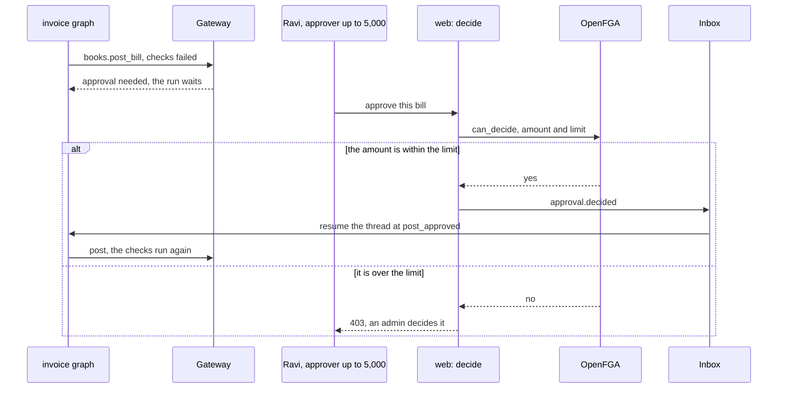
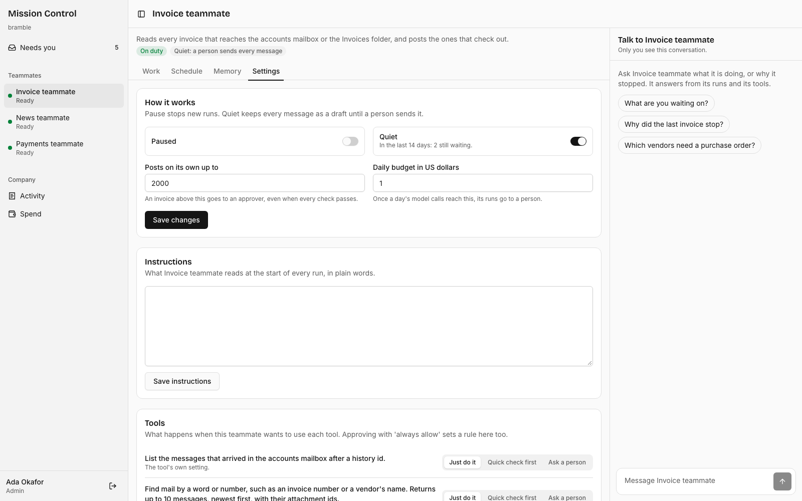

# Ask a person before a risky action

## Why

A teammate that holds the keys to the books can be talked into anything a clever invoice asks.
So it never holds them. The keys live in the gateway.

A policy decides each tool call. A policy is a set of rules that says allow, ask or deny. The risky calls wait for a person who may say yes.

For example, a bill that fails a check waits for an approver. The approver reads the brief and clicks Approve.

## Goal

You approve one held invoice and deny another. You see who may decide what, and the one rule nobody can turn off.

## Starting point

The stack is running, and two invoices wait in Needs approval from [Check every invoice before it posts](check-before-you-post.md).

## How it works

Every tool call goes to the gateway. A tool is one action the teammate may ask for, such as reading mail or posting a bill.
The gateway decides each call in one of three ways:

- **allow**: run it now. Reading mail, reading the books and posting a bill whose checks passed are allowed.
- **classify**: a quick model call judges the risk. A reply to a vendor goes this way.
- **approve**: stop the run and ask a person.

Before any of that, the gateway checks the tool against the teammate's definition. That definition lists the tools the teammate may use. The news teammate asking for `books.post_bill` gets 403. A 403 means "not allowed". The policy cannot change that.

A standing rule is a rule an admin sets for one tool. It can change that tool's default.
A tool with a `fixedPolicy` ignores rules.

Posting a bill always runs its checks. A pay run always waits for a person.
Clicking "Allow always" on an approval writes such a rule. It never writes a note to memory.

When the checks fail, `post` asks for an approval. The graph then waits.
A person decides on the card. The decision goes into the teammate's inbox as an event. The worker then resumes the saved thread where it stopped.

OpenFGA checks who may decide. OpenFGA is the permission service. It reads the person's sign-in from Keycloak, the sign-in service.

Ada is an admin and may decide any amount. Ravi may decide up to 5,000 EUR. Mei may only view.



## Run it

Open a held card and read its brief, the short summary the teammate wrote for you. Approve it. Open the other card and deny it with a note.

Open Activity. Under the outbox, the audit log has both decisions with your name and your note.

Sign in as `mei@bramble.example` in a private window. Mei sees the same cards. In place of the buttons, each card says she can view approvals but not decide them.

Open Settings as Ada. Each tool shows its default, and you can set a standing rule for it.



## Break it

A standing rule must never let a bill skip its checks, or a pay run skip its person. Otherwise one admin click turns them off for good.

1. Open `src/server/web-app.ts` and find `if (fixed) throw new HttpError(422, fixed);`.
2. Delete that line.
3. Run `npx tsx --test src/server/web-app.test.ts`. This test in `src/server/web-app.test.ts` fails:

   ```text
   "no standing rule can let a bill post without its checks, or a pay run go without a person"
   ```

4. Put it back. It passes.

## What you have now

- Keys in the gateway, never in the run.
- allow, classify and approve: the three choices for every tool. Standing rules can change them.
- Approvals check the role and the limit in OpenFGA. A run resumes after the answer.
