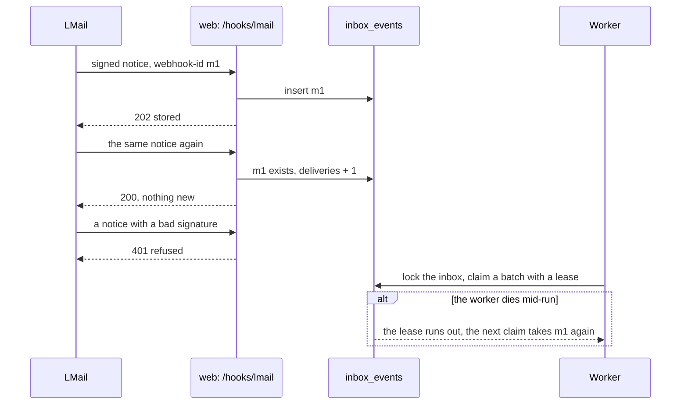

# Catch every event in a durable inbox

## Why

Mail and file notices arrive whenever they like.
Say the handler runs the teammate inside the request. A slow model call times out the sender, so the sender tries again.
If the process dies in the middle of the run, the event is gone. A process is a running program.

An always-on teammate needs a safe place to keep each event until the work is done. Durable means the event survives a crash.

For example, an invoice notice arrives while the model is slow. The notice waits in the inbox, so it is not lost.

## Goal

You see a notice stored once, even when it is delivered twice. Exactly one worker claims it. A claim means a worker marks an event as its own, so no other worker takes it.

## Starting point

The stack is running. You have sent at least one invoice in [Meet the apps your teammates work in](meet-the-world.md).

## How it works

The webhook handler in `src/server/hooks.ts` receives each notice. A webhook is a message that one app sends to another over the web when something happens.
The handler does three things, then answers at once:

1. It checks the Standard Webhooks signature. Standard Webhooks is an open format for signing these messages. A bad signature gets 401, which means "not allowed".
2. It stores the event in `inbox_events`. The key is made of the company and teammate, plus the source and the source id. Two copies of one notice have the same key.
3. It answers 202 for a new event and 200 for one it has seen. 202 means "accepted".

It never reads the mail and never runs a teammate.

The worker claims work in `src/server/inbox.ts`.
A lock lets one worker look at an inbox at a time. That worker takes a batch of events.

Each claim has a lease. A lease is a time limit on a claim. If the worker dies, the lease runs out. Then the next claim takes the events again.

After the last allowed attempt, the event is marked dead. A dead event failed every attempt, so no worker tries it again.

The article names three spans of time. This repo uses its words:

- A **run** is one batch of events, worked from start to end by one worker.
- A **session** is a thread that can span runs. For example, one invoice that waits for a person. LangGraph runs each teammate's steps. It saves the session. The next run carries on from where it stopped.
- A **cycle** is the loop of inbox, run and outbox that repeats all day. The outbox is where a teammate's messages wait to be sent.

A batch can hold three quick messages from one person. They get one answer. The answer is written from all three, not three answers.



## Run it

Look at the inbox table while you send an invoice:

```bash
npm run invoices:send -- 02-kestrel-design
docker exec teammates-platform-postgres-1 \
  psql -U teammates -d teammates -c "SELECT id, source, type, status, deliveries, attempts FROM inbox_events ORDER BY id DESC LIMIT 5"
```

Expect: the new row moves from `queued` to `claimed` to `done` as the worker takes it. Run the query again to see each step.

On the board, the card passes through Inbox and Working.

## Break it

The unique key is what makes a second delivery harmless. A second delivery must not make a second row.

1. Open `src/server/inbox.ts` and find `receive`.
2. Change `ON CONFLICT (company, teammate, source, source_id) DO UPDATE SET deliveries = inbox_events.deliveries + 1` to `ON CONFLICT (id) DO NOTHING`.
3. Run `npx tsx --test src/server/inbox.test.ts`. This test in `src/server/inbox.test.ts` fails:

   ```text
   "the same event delivered twice is stored once"
   ```

4. Put it back. It passes.

## What you have now

- A handler that only checks, stores and answers.
- An inbox that keeps each event once, until a run finishes it.
- One worker per inbox at a time, and a lease that recovers from a crash.
