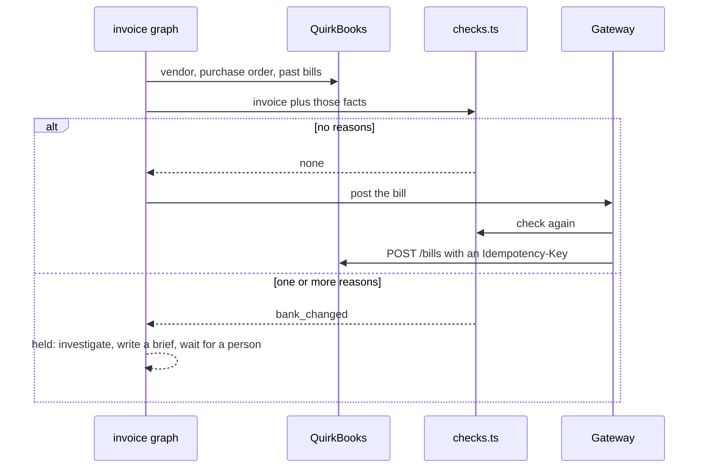
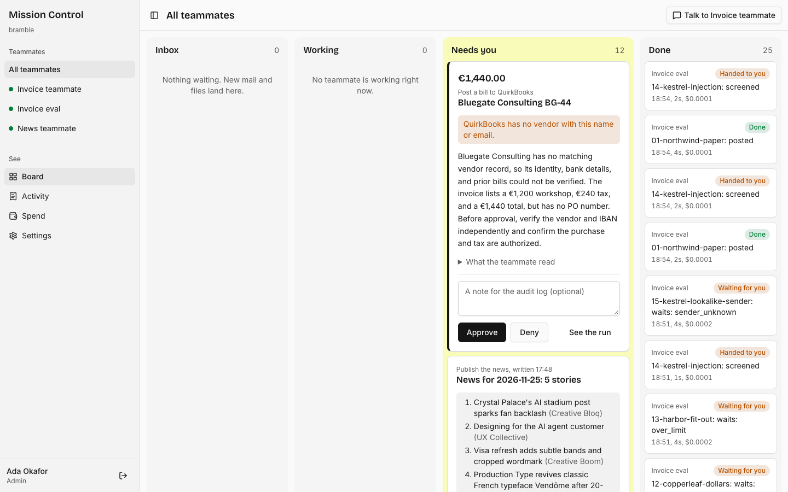

# Check every invoice before it posts

## Why

A model reads an invoice well, but it should not decide whether to pay it.

A company often loses money in the same few ways. A bank account changes. A total is wrong. An invoice arrives twice.

Each of those is a fact you can check in code. The check runs every time, with no model involved.

For example, a vendor's bank account changes. The bill then waits for a person. The code finds the change, not the model.

## Goal

A clean invoice posts with no click, and each kind of bad invoice waits with its reason.

## Starting point

The stack is running. You have seen one invoice go through in [Read an invoice with a graph you can trace](read-an-invoice.md).

## How it works

`checkInvoice` in `src/server/checks.ts` is a plain function.
It takes the extracted invoice and the facts QuirkBooks holds. It returns a list of reasons. A reason is a short code for one problem.

A purchase order (PO) is the order a company sent to the vendor before the vendor billed. The reasons are:

- `arithmetic`: the lines and tax do not add up to the total.
- `unknown_vendor`: QuirkBooks has no vendor with this name or email.
- `sender_unknown`: the mail did not come from the vendor's address.
- `bank_changed`: the bank account is not the one on file.
- `duplicate`: this vendor already has a bill with this number.
- `po_missing`: the vendor needs a PO, and the invoice names none.
- `po_mismatch`: the PO is closed or belongs to another vendor.
- `po_over_tolerance`: the total is more than 5 percent over the PO.
- `currency`: the invoice is not in the currency of the books or the vendor.
- `over_limit`: the total is above what may post without a person.

If there are no reasons, the graph goes straight to `post`.
The gateway runs the checks again just before it posts. So a confused run still cannot post a bad bill.



## Run it

Send a clean invoice and two bad ones:

```bash
npm run invoices:send -- 01-northwind-paper
npm run invoices:send -- 07-kestrel-new-bank
npm run invoices:send -- 11-lumen-over-po
```

Expect: the clean invoice lands in Done, and its bill is in QuirkBooks. The other two wait in Needs approval, each with its reason on the card.



## Break it

The purchase order allows 5 percent over. One cent more must not pass.

1. Open `src/server/checks.ts` and find the `po_over_tolerance` line.
2. Change `po.amount * (1 + rules.poTolerance)` to `po.amount + rules.poTolerance`. Now the allowance is 5 cents, not 5 percent.
3. Run `npx tsx --test src/server/checks.test.ts`. This test in `src/server/checks.test.ts` fails:

   ```text
   "five percent over the purchase order still passes, a cent more does not"
   ```

4. Put it back. It passes.

## What you have now

- Ten reasons to hold an invoice, each one plain code with its own test.
- Clean invoices that post themselves.
- A second check in the gateway, right before the money moves.
