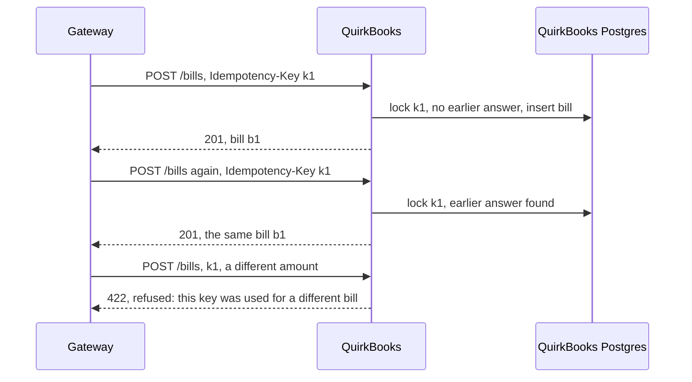
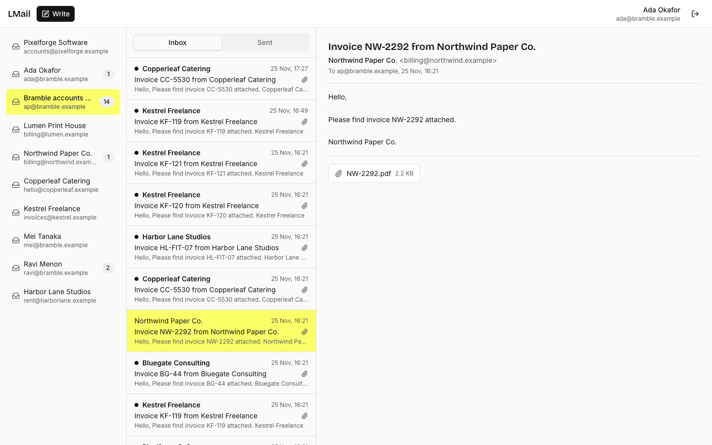
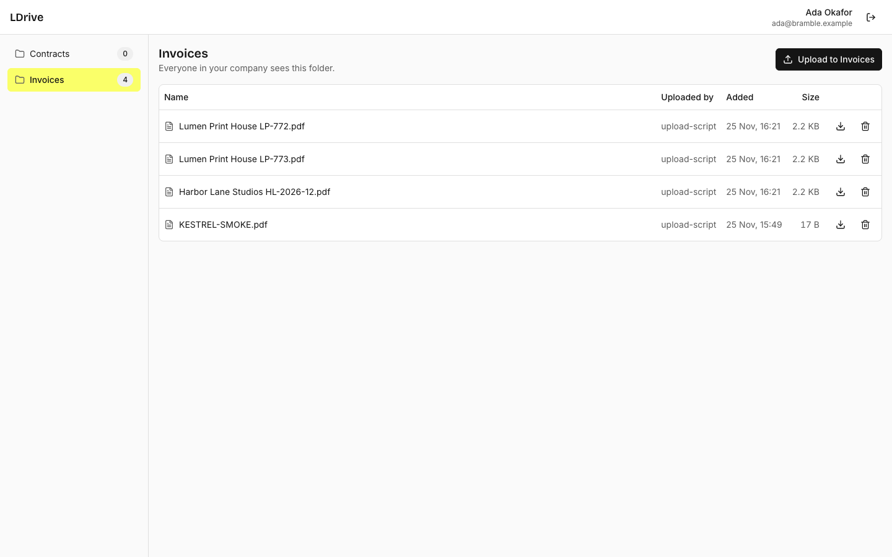
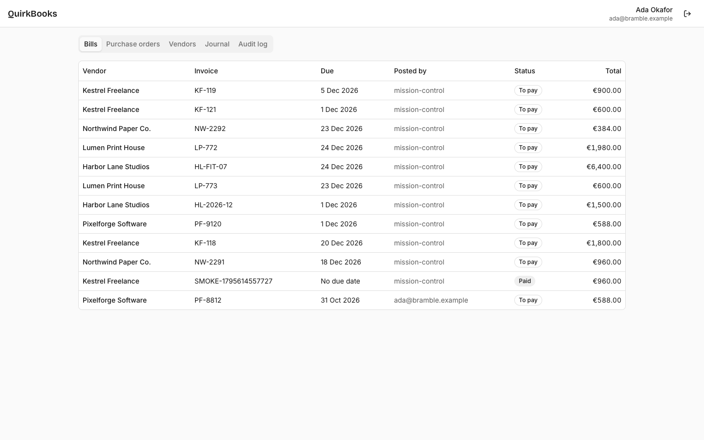

# Meet the apps your teammates work in

## Why

A teammate is only as real as the tools it works in.
If it works against a fake inbox, every lesson after this one proves nothing.

Here, three real apps handle mail. They also handle files and books. Each one has its own database, sign-in and API.
An API is the set of web addresses a program calls to read or change data.

For example, LMail takes a real email over SMTP. SMTP is the standard protocol that mail programs use to send mail.

## Goal

You send a real invoice by mail and see it land in LMail. You also see QuirkBooks keep one bill when a request comes twice.

## Starting point

The stack from [Start the stack](start-the-stack.md) is running, and you are signed in as Ada.

## How it works

- **LMail** (port 8801) takes real mail by SMTP on port 2525. When mail arrives in a watched mailbox, it sends a signed notice to Mission Control. The notice looks like Gmail's. It holds only the mailbox and a history number, which counts how far the mailbox has been read. The signature lets the receiver check who sent it.
- **LDrive** (port 8802) keeps folders in MinIO. A new file in a watched folder sends a notice shaped like Google Drive's.
- **QuirkBooks** (port 8803) keeps vendors, purchase orders and bills. A purchase order is an order a company sends to a vendor before the vendor bills it. QuirkBooks also keeps a double-entry journal, where each entry has two sides so the books always balance. Every write lands in its audit log. An audit log is the record of who changed what.

Mission Control is the board where people see the teammates' work. It reaches the three apps only through their APIs. It uses the keys that `npm run setup` wrote.

A network can drop an answer after the work is done. So a careful client sends the request again.
A retry is safe only when the server knows it already did the work.

QuirkBooks takes an `Idempotency-Key` on every bill. That key is a label the client sends with each request.
QuirkBooks locks on that label. It looks for an earlier answer and returns it instead of posting twice.
The same key with a different bill is refused.

The diagram shows a normal retry, and then a refusal.



## Run it

Send one clean invoice by mail:

```bash
npm run invoices:send -- 01-northwind-paper
```

Expect: the command ends without an error.

Open LMail at http://localhost:8801 and pick the Bramble accounts payable mailbox. This is the mailbox where vendors' bills arrive. The invoice is there with its PDF.



Open LDrive at http://localhost:8802. Its Invoices folder holds the cases sent as files.



Open QuirkBooks at http://localhost:8803. The Bills tab shows every bill and who posted it.



## Break it

Two workers can retry the same post at the same moment. A worker is a process that runs the teammates' jobs.
Without the lock, both see no earlier answer. Then both insert a bill.

1. Open `apps/quirkbooks/store.ts` and find `postBill`.
2. Delete the line with `pg_advisory_xact_lock`. That line takes the lock.
3. Run `npx tsx --test apps/quirkbooks/store.test.ts`. This test in `apps/quirkbooks/store.test.ts` fails:

   ```text
   "two posts with the same key at once still make one bill"
   ```

4. Put the line back. It passes again.

## What you have now

- Real mail in and real files in. Real books, each behind its own API.
- A bill post that is safe to retry, even two at once.
