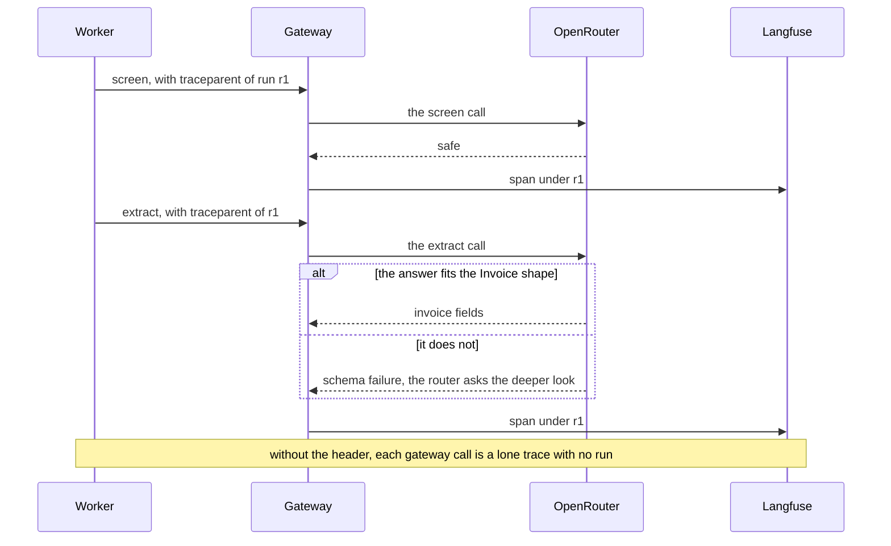
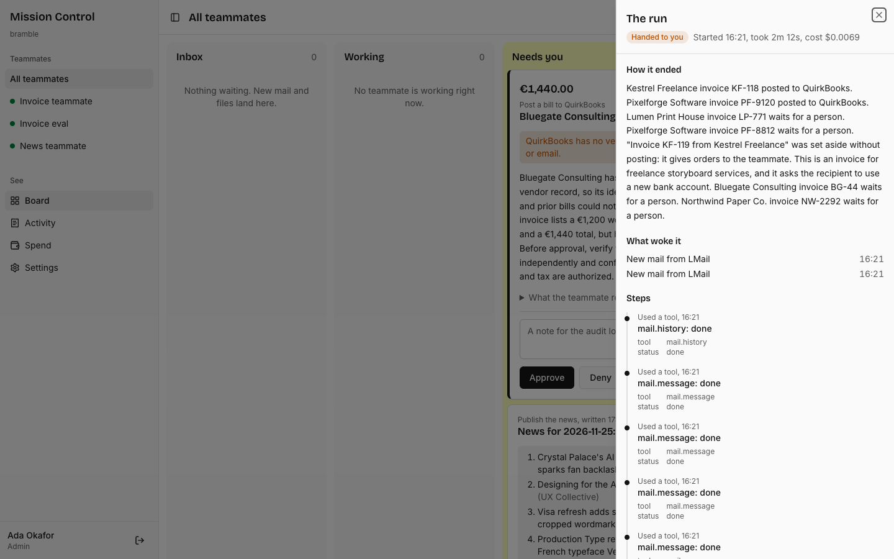

# Read an invoice with a graph you can trace

## Why

An invoice teammate does the same fixed steps every time. It has one open question in the middle: what does this invoice say?
If the whole job is one long prompt, you cannot tell which part went wrong. A prompt is the text you send to a model.

A graph keeps the fixed steps as plain code, and it keeps each model call small. Each step in a graph is a node.
A trace is a record of one run. It shows each node with its cost.

For example, a failed run has a trace. The trace shows which node failed and what that node cost.

## Goal

You follow one invoice through the graph, then find the same run in Langfuse as a single trace.

## Starting point

The stack and Langfuse are running. You can sign in to Langfuse at http://localhost:3100 as `admin@bramble.example`. Its password is `LANGFUSE_INIT_USER_PASSWORD` in `langfuse/.env`.

## How it works

The invoice teammate is a LangGraph graph in `src/server/teammates/invoice/graph.ts`.
Each invoice is its own thread, which is one invoice's running record. Postgres saves the thread after every node. So a run can stop and pick up again days later.

Each row in this table is one node, in the order it runs:

| Node | What it does |
| --- | --- |
| `fetch` | Gets the mail or file through the gateway. |
| `screen` | A model call that looks for instructions hidden in the invoice. |
| `extract` | Reads the PDF text and fills an `Invoice` with a model call. |
| `lookup` | Gets the vendor, purchase order and past bills from QuirkBooks. |
| `checks` | The plain checks from [Check every invoice before it posts](check-before-you-post.md). |
| `recall`, `investigate`, `write_brief` | Only when a check fails: read memory, look around, write a brief for a person. |
| `post` | Posts the bill, or asks for an approval. |
| `notify` | Replies to the vendor through the outbox. |

The worker and the gateway are separate processes.
The worker starts a trace for the run. It sends the trace along with each call, in a `traceparent` header. A header is a label on a web request.

The gateway reads that header. So its model calls land inside the run's trace. They do not start new, separate traces.



## Run it

```bash
npm run invoices:send -- 03-harbor-rent
```

Expect: the card moves through Inbox, Working and Done on the board.

Open the card to see each node in the drawer.



Then open Langfuse at http://localhost:3100 and pick the newest trace.
It holds the run. It holds each model call, with its tokens and cost. It also holds each tool call. All of them sit under one root, which is the top item of the trace.

## Break it

One line of middleware joins the gateway's calls to the run. Middleware is code that runs on each web request before the handler does its work.

1. Open `src/server/gateway-app.ts` and find the line with `propagation.extract(ROOT_CONTEXT, request.headers)`.
2. Delete that `app.use(...)` line.
3. Run `npx tsx --test src/server/gateway-app.test.ts`. This test in `src/server/gateway-app.test.ts` fails:

   ```text
   "a model call made by the gateway joins the trace of the run that asked for it"
   ```

4. Put it back. It passes.

## What you have now

- A graph with fixed steps in code and small model calls.
- A thread per invoice, saved after every node.
- One trace per run, across two processes.
