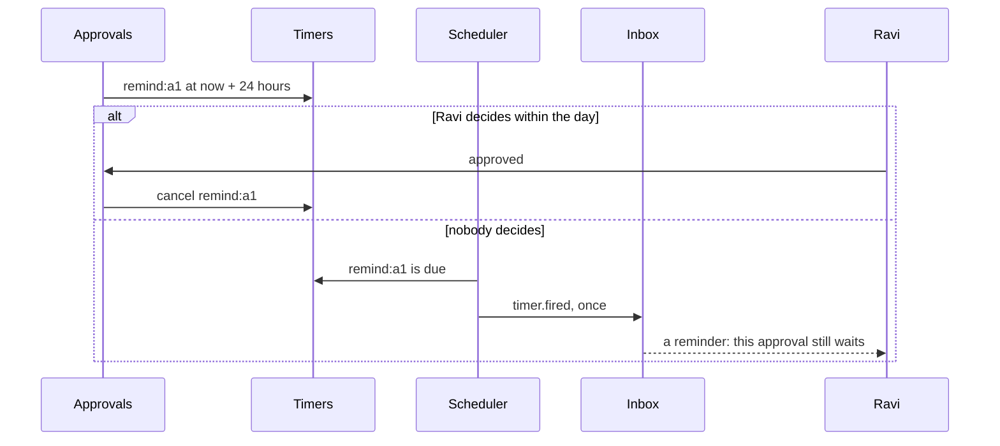
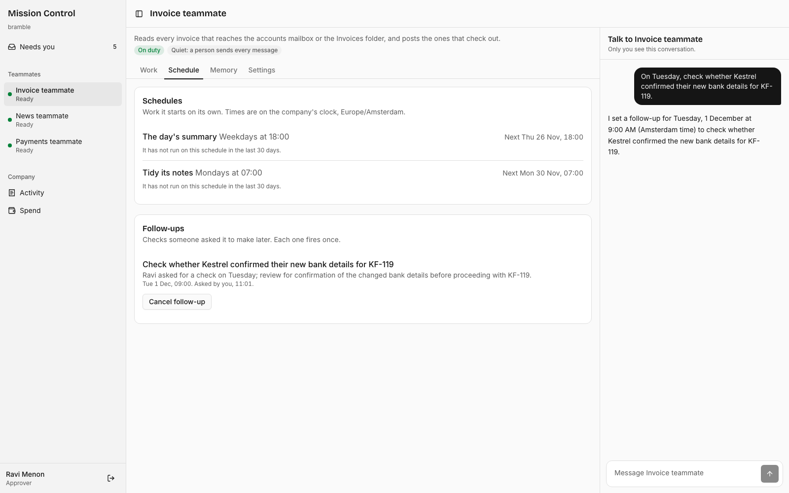
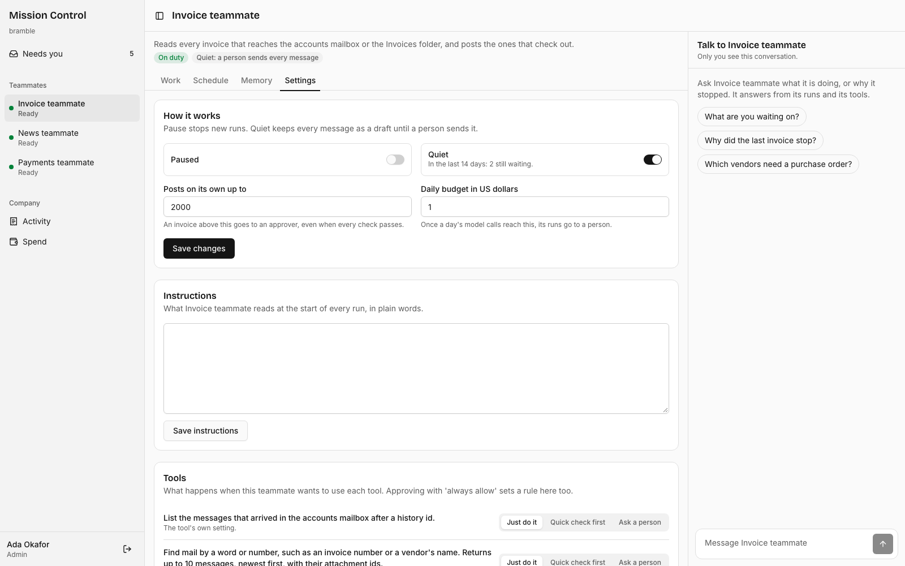
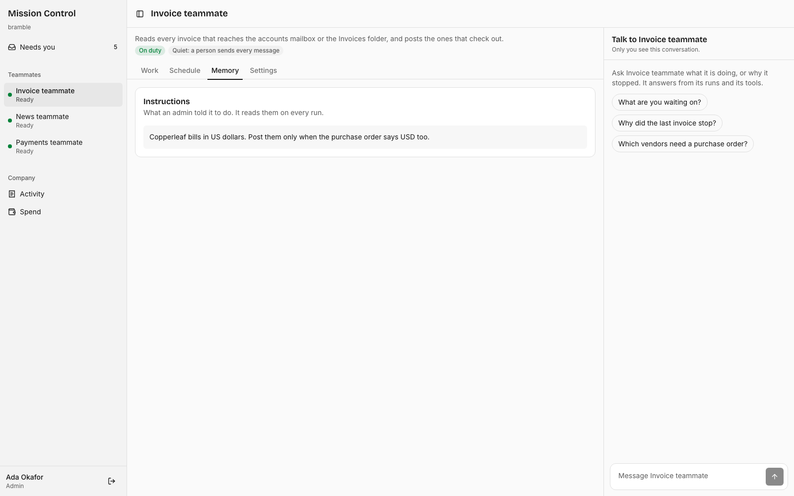

# Follow up on time and remember what people decided

## Why

An approval that nobody answers sits there for a week. The vendor waits for its money.
An always-on teammate needs a clock it can trust, and a memory that outlives every run.

For example, Ravi approved a vendor's new bank account last month. A teammate that forgets this asks him again.

## Goal

You see the reminder an approval sets and the daily schedules. You also see a vendor note written from a decision.

## Starting point

The stack is running. At least one approval was decided in [Ask a person before a risky action](ask-before-acting.md).

## How it works

**Timers** live in their own table, in `src/server/timers.ts`. A timer is either a schedule or a single time.
A schedule uses a cron line, a short pattern that sets repeated times. It runs in the company's time zone.

- The invoice teammate sends a digest at six on working evenings. A digest is a short summary.
- The news teammate starts its edition at seven on working mornings. An edition is one day's set of news cards.
- Every new approval sets a reminder for 24 hours later. A decision cancels it.

The scheduler never starts a run. It writes each due timer into the teammate's inbox, once. A due timer is one whose time has come.
The worker takes it like any other event.
A scheduler that was down for days fires a schedule once, not once per missed time.

**Memory** is a folder of plain text files for each teammate, in `src/server/memory.ts`. It lives on S3, a file storage service. On your laptop, MinIO plays that role.
Memory holds only what cannot be looked up again:

- `instructions.md`: what a person wants the teammate to know. An admin edits it in Settings, and every run reads it.
- `index.md`: one line per note, so a run knows what it can look up. The gateway keeps it, never a model.
- `reported.md`: what the teammate already told each person. A teammate never tells a person the same thing twice.
- `notes/vendor-<id>.md`: one note per vendor, written from each decision a person made. A note keeps only its newest 30 lines.
- `progress/<task>.md`: where a task that takes more than one run got to, such as a follow-up.

The first three load every run. Notes and progress are read only when a run needs them.

Once a week the teammate tidies its notes. The article calls this "dreaming".
It proposes a shorter note as a draft in the outbox. The note changes only after a person reads the new lines and sends them.

A teammate can also set a timer for itself with `team.follow_up`. It can set one at most 14 days ahead. [Talk to a teammate and hand it work](talk-to-a-teammate.md) shows one.

Facts that live in QuirkBooks or LMail stay there. Memory never copies them.



## Run it

Send an invoice that will wait, and look at its reminder:

```bash
npm run invoices:send -- 06-pixelforge-duplicate
docker exec teammates-platform-postgres-1 \
  psql -U teammates -d teammates -c "SELECT name, cron, fire_at, status FROM timers ORDER BY fire_at"
```

Expect: the standing schedules, and one `remind:` timer a day ahead.

Approve the invoice and run the query again. The reminder's status is now `cancelled`.

You do not need psql to see this. Psql is the Postgres command line.

In Mission Control, click Invoice teammate in the sidebar. Then open the Schedule tab. It lists the same timers, each with its next time. A follow-up shows who asked for it, and that person can cancel it there.



Open Settings as Ada. Add a line to the invoice teammate's instructions. For example: Copperleaf bills in US dollars. The next run reads it.



Now open the Memory tab. It shows the instructions and every note the teammate keeps. Ada can delete a wrong note.
Sign in as Mei. She sees the instructions only, because viewers never see the notes.



## Break it

A reminder that outlives its approval nags people about something already done.

1. Open `src/server/approvals.ts` and find `cancelTimer` in `decide`.
2. Delete that line.
3. Run `npx tsx --test src/server/timers.test.ts`. This test in `src/server/timers.test.ts` fails:

   ```text
   "an approval sets a reminder for a day later, and a decision cancels it"
   ```

4. Put it back. It passes.

## What you have now

- Schedules and follow-ups in their own table, fired once into the inbox.
- A reminder on every approval, cancelled by the decision.
- Instructions and vendor notes that outlive every run, and nothing copied from the books.
