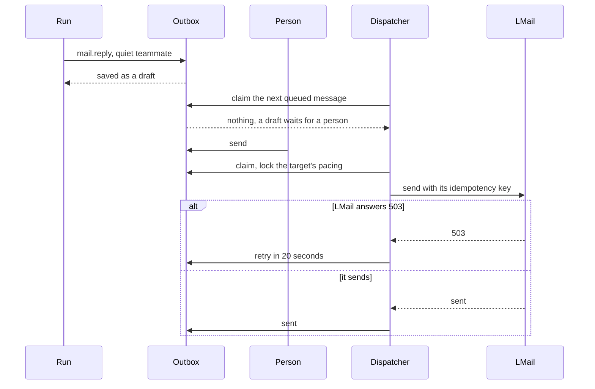
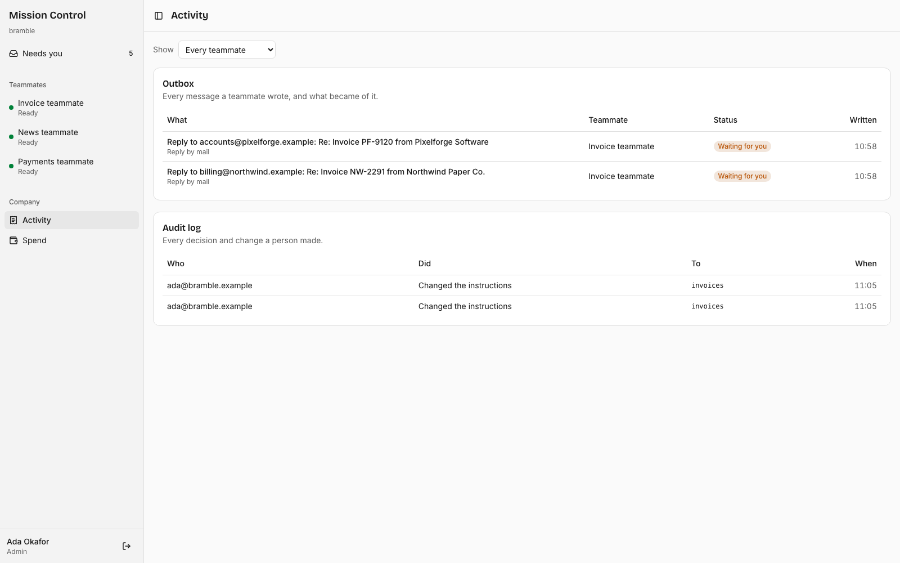

# Send safely, then score the teammate

## Why

A teammate's last step is to talk to the outside world. It replies to a vendor, or puts a page on the web.
If it sends inside the run, a crash after sending makes it send again. A burst of runs can flood one inbox.
And before you let a teammate send on its own, you want numbers that show it is right.

For example, a crash after a reply goes out makes the run send it again. A key on each message stops that.

## Goal

You release a quiet teammate's draft and see the dispatcher pace and retry. Then you run the invoice scoreboard.

## Starting point

The stack is running. The news edition from [Publish the morning news](publish-the-morning-news.md) went through the outbox.

## How it works

A run never sends anything. Its tools write a row to the outbox, in `src/server/outbox.ts`. A row is one message waiting to go out.
The dispatcher sends rows one at a time:

- **Quiet first.** A new teammate is quiet. Its messages wait as drafts until a person sends or discards them. Turn quiet off in Settings once you trust the teammate.
- **Pacing.** At most one send per target every 2 seconds. A target is where a message goes, such as one mailbox. The pacing row is locked with the message, so two dispatchers cannot both send.
- **Retries.** A failure that a retry can fix waits 20 seconds, then twice as long each time. For example, the first wait is 20 seconds. The next is 40, and then 80. It stops after 6 attempts. A failure that a retry cannot fix is dead at once, with its reason.
- **Idempotency.** Every message carries a key. Idempotency means a repeat does the same thing once. So a resend after a crash is the same send, and nothing goes out twice.

Turning quiet off is a decision you make from evidence.
Settings shows the last 14 days. It counts what the teammate sent on its own, and what people released or discarded. It also counts what still waits.

Each teammate also has an eval. An eval is a scored test of the teammate's answers. Run it with `npm run teammate:eval -- <kind>`. Its score must hold before quiet goes off.



## Run it

Open Activity. The outbox table shows every message a teammate wrote and what became of it. "Waiting for you" means the message is a draft.



Now score the invoice teammate on all fifteen cases, with real model calls:

```bash
npm run invoices:run
```

Expect: the run ends with no failure.

The run sends every case and waits for each one to finish. Then it compares each result with what `data/invoices/cases.ts` expects.

Two numbers matter. Wrong postings must be zero. Every clean invoice must post with no click.
`docs/coverage.md` maps each case to the promise it proves.

## Break it

A draft is a promise that nothing goes out until a person says so.

1. Open `src/server/outbox.ts` and find `message.status = 'queued'` in `claim`.
2. Change it to `message.status IN ('queued', 'draft')`.
3. Run `npx tsx --test src/server/dispatcher-loop.test.ts`. This test in `src/server/dispatcher-loop.test.ts` fails:

   ```text
   "a draft is never sent until a person releases it"
   ```

4. Put it back. It passes.

## What you have now

- Every send sits in one table. Each send is paced, retried and keyed.
- A teammate that starts quiet and earns the right to send.
- A scoreboard that proves zero wrong postings before you trust it.
